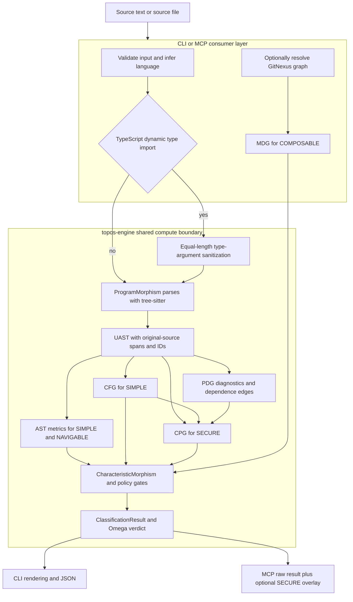

# System Architecture Overview

Topos is a category-theoretic system for structural software quality evaluation and static program analysis. The Cargo workspace (version 0.14.0) consists of three Rust crates: `topos-engine` (`topos/engine`), `topos` (`topos/cli`), and `topos-mcp` (`topos/mcp`).

The `topos-engine` crate is a pure, transport-free analysis engine with no CLI, MCP, or Python runtime concerns. It owns source parsing, language dispatch, unified AST (UAST) mapping, graph construction (CFG, PDG, CPG, MDG), metric probes, quality policy translation, and raw characteristic classification.

Both consumer crates depend on `topos-engine`. The `topos-mcp` crate implements a Model Context Protocol (MCP) server over stdio for agent interaction, and `topos` is the CLI binary that consumes `topos-engine` directly while embedding `topos-mcp` to support the `topos mcp` subcommand.

## Workspace Crate Topology

```mermaid
flowchart TD
    subgraph CLI["topos (CLI binary)"]
        CLICmds["Command Handlers (evaluate, inspect, etc.)"]
        CLIMcp["mcp subcommand"]
    end

    subgraph MCP["topos-mcp (MCP server)"]
        MCPServer["ServerHandler and Tool Router"]
        MCPDiag["Diagnostics and Allowlist Overlay"]
        MCPDep["Depgraph Cache Store"]
    end

    subgraph Engine["topos-engine (Shared Compute Engine)"]
        Core["core (Morphism, Omega, CharacteristicMorphism)"]
        Graphs["graphs (UAST, CFG, PDG, CPG, MDG)"]
        Functors["functors (probes, metrics)"]
        Evaluation["evaluation (policies, gates, suppression)"]
        Adapters["adapters (GitNexus, filesystem)"]
        Config["config (.topos.toml)"]
    end

    CLICmds --> Engine
    CLIMcp --> MCPServer
    MCPServer --> MCPDiag
    MCPServer --> MCPDep
    MCPServer --> Engine
    MCPDiag --> Evaluation
```

*Caption: Workspace crate dependency topology and key module boundaries across topos CLI, topos-mcp, and topos-engine.*

## Categorical and Mathematical Framework

Topos models a codebase as a topos $\mathcal{E} = \mathbf{Set}^{\mathcal{C} \times \mathcal{H}^{\text{op}}}$, where:
- Objects are program representations (ASTs, call graphs, dependence graphs).
- Morphisms $f: A \to B$ are structure-preserving transformations (refactors and code evolutions).
- The subobject classifier $\Omega$ is the free Heyting algebra generated by four quality pillars: `SIMPLE`, `COMPOSABLE`, `SECURE`, and `NAVIGABLE`.

The characteristic morphism $\chi_S : P \to \Omega$ classifies a program $P$ by mapping its measured structural properties through policy functions $\Phi_i$ into the Heyting algebra.

### Evaluation Values and Lattice Mechanics

`Omega` represents truth values in the Heyting algebra. The four generators combine into 16 subset states ranging from `SLOP` (bottom element, $\bot$, no quality pillars satisfied) to `IDEAL` (top element, $\top$, all four quality pillars satisfied).

A single-file evaluation evaluates each pillar through a policy translator $\Phi_i$. For multi-file evaluations, `combine_dimensions` computes the pointwise lattice meet $\bigwedge_f \chi_S(f)$ across files:
- A quality pillar is satisfied for the codebase if and only if it is satisfied by **every** file that evaluated it.
- Unmeasured dimensions (such as `COMPOSABLE` when no dependency graph is available) do not invalidate other pillars.
- Parse failures collapse the overall file classification to `SLOP`, causing multi-file aggregation to fail all reported pillars.

## From Source to Verdict

`ProgramMorphism` owns the original source text, language identifier, optional file path, parsed `ProgramObject`, and lazily cached control flow graph (`ControlFlowGraph`), program dependence graph (`ProgramDependenceGraph`), and code property graph (`CodePropertyGraph`). Construction immediately attempts parsing using tree-sitter across supported languages (Python, Rust, JavaScript, TypeScript, C++, and Go).

Before parsing TypeScript source, dispatch identifies dynamic `import` expressions inside generic type arguments, such as `load<typeof import("...")>()`. It replaces the type argument text with `any` and padding spaces without altering byte length. This prevents tree-sitter from misinterpreting `<` as a relational comparison while maintaining exact byte offsets for source spans.

*Caption: Data and control flow turning program source and representations into a raw classification, CLI output, or MCP result.*

### Representation Assembly

| Representation | Scope | Classification Role |
| --- | --- | --- |
| UAST / `AstRepresentation` | Single parsed file | Compression entropy and worst-function complexity feed `SIMPLE`. |
| `NavigableRepresentation` | Same UAST | Maximum Semantic Compositional Divergence (SCD) across functions feeds `NAVIGABLE`. |
| `ControlFlowGraph` (CFG) | All callables in file | Provides control-flow structure and `cfg.cyclomatic` complexity for `SIMPLE`. |
| `ProgramDependenceGraph` (PDG) | Intra-procedural statements | Connects data and control dependences; feeds `CodePropertyGraph` construction. |
| `CodePropertyGraph` (CPG) | Single file | Merges AST, CFG, DDG, and CDG edges to compute dangerous call and taint path metrics for `SECURE`. |
| `ModuleDependencyGraph` (MDG) | Cross-file repository topology | GitNexus-derived graph providing inter-module coupling and stability metrics for `COMPOSABLE`. |

`ProgramMorphism` caches derived graphs lazily. CPG construction independently projects block-level CFG edges between statement boundaries while retaining AST, CFG, DDG, and CDG edges. PDG data dependence uses textual-order reaching definitions without full flow-sensitive alias analysis.

## Classification Semantics and Policy Translation

For syntactically valid code, `CharacteristicMorphism` always generates `AstRepresentation` and `NavigableRepresentation`, measuring `SIMPLE` and `NAVIGABLE`. Callers attach CFG and CPG representations for `SECURE` measurements, and an MDG for `COMPOSABLE`.

Metrics are routed by namespace:
- `ast.*` and `cfg.*` $\to$ `SIMPLE`
- `mdg.*` and `pdg.*` $\to$ `COMPOSABLE`
- `cpg.*` $\to$ `SECURE`
- `nav.*` $\to$ `NAVIGABLE`

Policy translators ($\Phi_{\text{SIMPLE}}$, $\Phi_{\text{COMPOSABLE}}$, $\Phi_{\text{SECURE}}$, $\Phi_{\text{NAVIGABLE}}$) evaluate raw metrics against policy gates. Each policy returns a `ScoredDecision` containing a continuous score in $[0.0, 1.0]$ and an `achieved` Boolean computed as an unweighted AND across raw metric gates. `Priority` is retained in classification metadata to guide agent priority preferences, but does not alter individual gate thresholds.

### Pillar Input Definitions

- **SIMPLE**: Evaluates source compression entropy and worst-function cyclomatic/AST complexity. Whole-file CFG cyclomatic metrics are advisory to avoid penalizing large single files composed of small functions. Import/export entrypoint modules receive specific entropy exemptions.
- **NAVIGABLE**: Gates `nav.max_function_divergence` (Semantic Compositional Divergence). It measures deeply nested block scopes and fanout rather than flat sequential branches.
- **SECURE**: Evaluates reachable dangerous APIs and source-to-sink taint paths using CPG analysis. Both counts must equal zero to pass the raw SECURE gate. Raw classification uses an empty allowlist.
- **COMPOSABLE**: Evaluates inter-module coupling, instability, fan-in/fan-out, and dependency depth from the GitNexus MDG. File-level evaluation emphasizes fan-out while accounting for entrypoint and leaf module roles.

The [quality model](../domain/quality-model.md) provides detailed product-level references for policy thresholds and gate specifications.

## Identity and Graph Safety Contracts

Nodes in the UAST preserve original parser provenance and source spans while receiving deterministic IDs computed using BLAKE2b over language, node kind, span, and parent ID.

Cross-representation references use `node_key`, which selects the deterministic UAST ID or falls back to an `anon::<address>` identifier for synthetic nodes. Synthetic addresses are valid only for the lifespan of that specific in-memory UAST.

Cloning, equality comparisons, and destruction passes on UAST and CPG instances are implemented iteratively to prevent call-stack overflow on deeply nested ASTs. CFG longest-acyclic-path algorithms ignore explicit `Loopback` and `Continue` edges, degrading to `0` if unexpected cycles are encountered rather than overflowing or panicking.

## Consumer and Operational Boundaries

### CLI Boundary (`topos`)

The CLI commands (`evaluate`, `inspect`, etc.) discover supported source files recursively when language filters are omitted. Unless `--no-composable` is specified, `evaluate` and `inspect` attempt to resolve or generate `.gitnexus` index data via `gitnexus analyze`. If GitNexus resolution fails (e.g., missing binary or schema mismatch), the evaluation degrades gracefully to measure the remaining three pillars with a notice printed to stderr.

### MCP Server Boundary (`topos-mcp`)

The MCP server provides tool interfaces (`topos_evaluate_file`, `topos_evaluate_code`, `topos_inspect_code`, `topos_depgraph_status`) over stdio.

Inline code evaluations (`topos_evaluate_code`) cannot attach an MDG because inline snippets lack a file path for repository graph lookup; COMPOSABLE is marked as unmeasured. File evaluations (`topos_evaluate_file`) load depgraphs via a process-wide `STORE_CACHE` keyed by directory path, Git branch, and `.gitnexus` modification time, retargeting loaded graph data across files in the same project.

### Security Allowlist Overlay

Raw engine classifications (`ClassificationResult`) always reflect unsuppressed security findings.

When a parseable raw classification fails `SECURE`, MCP constructs a CPG and applies project config (`.topos.toml`) and one-off tool allowances:
1. Raw CPG findings are partitioned into active and acknowledged risks.
2. Adjusted SECURE status is recomputed using filtered active counts.
3. If acknowledged risks exist and the adjusted element would yield `IDEAL`, the grade is capped by clearing SECURE in the adjusted lattice element and setting `grade_capped = true`.

```mermaid
flowchart TD
    RawResult["ClassificationResult (Raw Engine Output)"] --> Guard{"Parseable and SECURE failed?"}
    Guard -->|no| RawOnly["Return raw result without overlay"]
    Guard -->|yes| BuildCPG["Build CPG and extract raw security findings"]
    BuildCPG --> Config["Load .topos.toml and merge one-off CLI/MCP allows"]
    Config --> Partition["Partition findings: Active vs Acknowledged"]
    Partition --> Recount["Recompute adjusted SECURE counts from CPG"]
    GradeCap{"Adjusted SECURE pass but raw element is IDEAL?"}
    GradeCap -->|yes| Demote["Cap grade: set grade_capped = true"]
    GradeCap -->|no| Emit
    Demote --> Emit["Emit AdjustedVerdict with raw and adjusted elements"]
```

*Caption: Diagnostic transformation flow applying the allowlist overlay to compute an adjusted SECURE verdict without altering canonical raw engine evidence.*

See [agent and CLI workflows](../workflows/agent-and-cli.md) for interface contracts, [distribution](../integrations/distribution.md) for GitNexus integration context, and [testing and release operations](../operations/testing-and-release.md) for operational validation procedures.

## Safe Extension and Testing Guidelines

- **Adding a language**: Register the language in tree-sitter dispatch, suffix discovery, and UAST mapping functions. Ensure TypeScript dynamic-import sanitization maintains exact byte lengths to preserve span alignment.
- **Adding a metric**: Implement probe calculation on the appropriate `Representation` type using a unique namespace prefix, then route the metric in `CharacteristicMorphism`.
- **Modifying policy gates**: Maintain raw gate evaluation and remediation metadata in `evaluation/policies/gates.rs` to keep CLI, MCP, and suggestion engine results synchronized.
- **Testing**: Run `cargo test -p topos-engine` for core graph and evaluation tests, and run `topos-cli` and `topos-mcp` integration suites to verify consumer interfaces.
