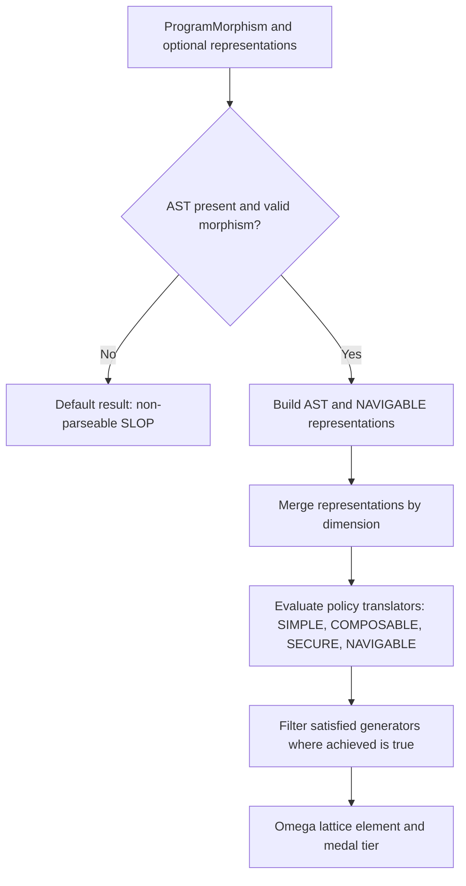
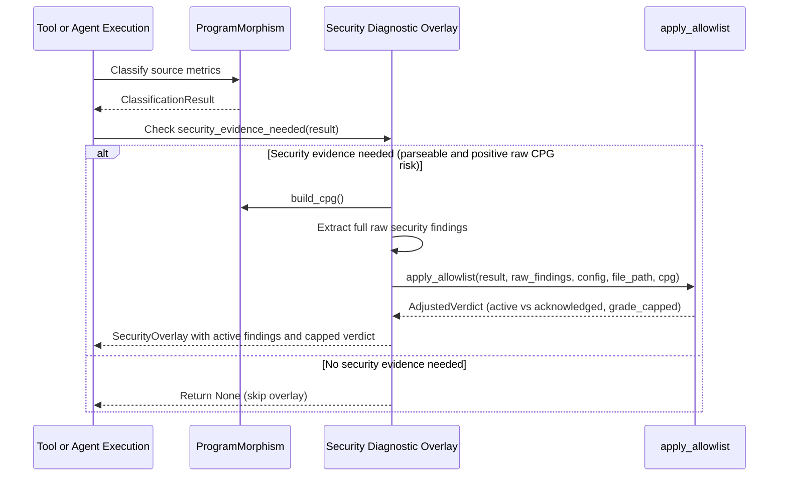
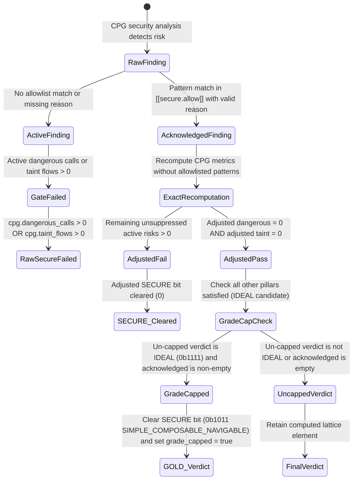
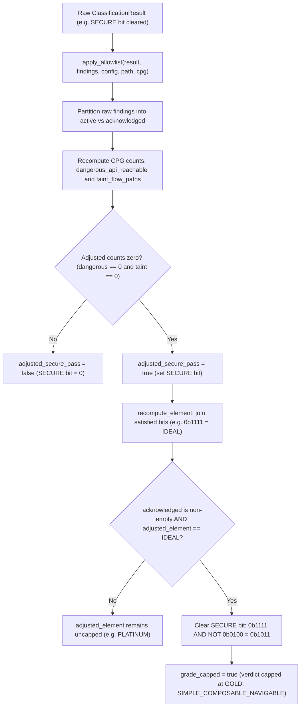

Topos expresses source quality through category-theoretic principles using four independent generator atoms: **SIMPLE**, **COMPOSABLE**, **SECURE**, and **NAVIGABLE**. In the category of programs, source code functions as a `ProgramMorphism` between computational states. The evaluation lattice codomain $\Omega$ acts as a subobject classifier (a 16-element Heyting algebra), while `CharacteristicMorphism` computes the unique characteristic map $\chi_S : P \to \Omega$ that evaluates each program morphism against canonical raw-metric gate thresholds.

An `EvaluationValue` represents the subset of generator atoms that pass their raw-metric gates. The satisfied subset forms a 16-element lattice rather than a continuous score scale. An `IDEAL` verdict indicates that all four generators are satisfied and corresponds to the **PLATINUM** medal tier. Satisfying three, two, one, or zero pillars yields **GOLD**, **SILVER**, **BRONZE**, and **SLOP** respectively. For example, satisfying `SIMPLE`, `COMPOSABLE`, and `SECURE` yields `SIMPLE_COMPOSABLE_SECURE` (GOLD), which is distinct from `IDEAL`.

Because generator atoms are incomparable in the Heyting algebra, consumers requiring lattice comparisons must use `Omega::leq` rather than bitwise or integer operations. `Omega` also implements generic Heyting lattice operations (meet, join, relative pseudo-complement) and aggregate operations (`Omega::aggregate`), where an empty aggregate evaluates to `IDEAL` by empty-meet convention.

| Pillar | Canonical Input and Gate Threshold | Representation Availability |
| --- | --- | --- |
| **SIMPLE** | `ast.entropy` in `0.2..=0.8` and `ast.max_function_complexity <= 10` | Every parseable source file |
| **COMPOSABLE** | `mdg.fan_out <= 10` | When Module Dependency Graph (MDG) observations are attached |
| **SECURE** | `cpg.dangerous_calls == 0` and `cpg.taint_flows == 0` | When Code Property Graph (CPG) observations are attached |
| **NAVIGABLE** | `nav.max_function_divergence <= 10.0` | Every parseable source file |

For broader architecture context, see the [Architecture Overview](../architecture/overview.md) and [Agent and CLI Workflows](../workflows/agent-and-cli.md).

## Subobject Classifier and Characteristic Morphisms

Categorical program evaluation structures the relationship between programs, subobject classifiers, and evaluation values:

- **Program Morphism ($P$)**: Encapsulated by `ProgramMorphism`, viewing source code and its AST/graph representations as an arrow $f: A \to B$ between state objects.
- **Subobject Classifier ($\Omega$)**: Implemented in `Omega`, representing truth values as a 16-element Heyting algebra lattice generated by the power set of $\{ \text{SIMPLE}, \text{COMPOSABLE}, \text{SECURE}, \text{NAVIGABLE} \}$.
- **Characteristic Morphism ($\chi_S : P \to \Omega$)**: Implemented by `CharacteristicMorphism`, mapping every program morphism $P$ to its characteristic evaluation value in $\Omega$.

`CharacteristicMorphism::classify_detailed` is the canonical entry point for program classification. If source code fails to parse or the `ProgramMorphism` is invalid (`is_valid() == false`), the classifier returns a default non-parseable result (`is_parseable = false`) with value $\bot = \text{SLOP}$.

For valid source code, `classify_detailed` automatically constructs `AstRepresentation` and `NavigableRepresentation` from the UAST. It merges any caller-supplied optional representations (such as MDG or CPG graphs) by dimension, executes policy translators ($\Phi_{\text{SIMPLE}}$, $\Phi_{\text{COMPOSABLE}}$, $\Phi_{\text{SECURE}}$, $\Phi_{\text{NAVIGABLE}}$), records each policy's `achieved` state, and joins only the satisfied generator bits into the final lattice verdict.


*Quality evaluation flow: valid source constructs local representations, merges optional graph metrics by dimension, and joins satisfied generator bits into the final Omega lattice verdict.*

`SIMPLE` and `NAVIGABLE` are measured locally for every parseable file. If MDG representations are omitted, `composable` remains unmeasured; if CPG representations are omitted, `secure` remains unmeasured. **Unmeasured is strictly distinct from failed or passed**: missing optional evidence leaves a pillar unmeasured without granting a pass or forcing a failure bit.

## Gates, Scores, and Policy Translators

Each policy translator returns a `ScoredDecision` structured into separate concerns:

- `achieved`: A Boolean indicating whether all registered raw-metric gates passed (`GateResult::passed`). The classifier uses this flag to set the pillar's bit in the lattice verdict.
- `score`: A normalized floating-point value ($[0.0, 1.0]$) derived from metric desirability functions and advisory readings. Reporting scores do not override raw gates or manipulate lattice bits.
- `interpretation` and suggested actions: Textual explanations provided for CLI/MCP display.

Gate evaluation is centralized in `evaluate_gates` (`gates.rs`), serving as a single source of truth for classifiers, diagnostic tools, and refactor target generators. The gate registry includes `NaN` guards that fail closed, ensuring non-numeric or missing metric values never pass bounded gate comparisons.

```
                  ┌─────────────────────────────────────┐
                  │          Raw Metric Values          │
                  └──────────────────┬──────────────────┘
                                     │
                        evaluate_gates / NaN Guard
                                     │
                  ┌──────────────────┴──────────────────┐
                  ▼                                     ▼
        Gate Pass (achieved = true)           Gate Fail (achieved = false)
                  │                                     │
                  ▼                                     ▼
      Set Generator Bit in Ω                Clear Generator Bit in Ω
                  │                                     │
                  └──────────────────┬──────────────────┘
                                     ▼
                          Lattice Join (Omega)
```

### SIMPLE: Local Code Structure

`SIMPLE` measures function-level complexity and AST entropy:
- `ast.entropy`: Must fall within the inclusive band `0.2..=0.8`.
- `ast.max_function_complexity`: Must not exceed `10`.

Import/export entrypoint modules (`is_entrypoint_module`) are exempted from entropy gate failures. Whole-file cyclomatic complexity (`cfg.cyclomatic`, threshold `15`) is evaluated as a codebase-relative advisory rather than a gate: because whole-file complexity aggregates across all functions, gating on it would unfairly penalize files containing many small, simple functions. Advisory scores are surfaced for context but do not clear the `SIMPLE` gate bit.

### COMPOSABLE: Outward Dependency Burden

`COMPOSABLE` evaluates structural coupling and module dependencies:
- Decisive gate: `mdg.fan_out <= 10`.

Module instability (`mdg.instability`) and fan-in (`mdg.fan_in`) are measured as codebase-relative advisories when coupling is non-trivial ($\text{coupling} \ge 2.0$). Advisory readings do not alter the `mdg.fan_out` gate result. When no MDG is provided, `COMPOSABLE` is marked unavailable rather than failed.

### SECURE: Zero-Tolerance and Suppression Overlay

`SECURE` enforces zero-tolerance security requirements:
- Gates: `cpg.dangerous_calls == 0` and `cpg.taint_flows == 0`.

Any nonzero dangerous call or taint flow clears the `SECURE` generator bit. Desirability scoring for security is reporting-only and cannot compensate for active vulnerabilities.

#### Security Diagnostic Overlay and Suppression Mechanics

In MCP tool execution (`diagnostics.rs`), security evidence is evaluated lazily through a diagnostic overlay. The overlay checks `overlay_applies` (calling `security_evidence_needed`) before reparsing source or constructing a full `ProgramMorphism`:

```rust
pub(crate) fn security_evidence_needed(result: &ClassificationResult) -> bool {
    result.is_parseable
        && (result.raw_metrics.get("cpg.dangerous_calls").copied().unwrap_or(0.0) > 0.0
            || result.raw_metrics.get("cpg.taint_flows").copied().unwrap_or(0.0) > 0.0)
}
```

If `security_evidence_needed` returns true, the overlay loads project configuration (`.topos.toml`), constructs the CPG, extracts un-filtered raw security findings (`allow: None`), and passes both raw findings and the CPG to `apply_allowlist` (`suppression.rs`). Supplying raw findings ensures `apply_allowlist` partitions active versus acknowledged findings correctly without bypassing disclosures or grade caps.


*Diagnostic mapping flow: the security overlay guards against unnecessary CPG construction and applies allowlists to raw findings without blinding risk disclosures or bypassing grade caps.*

Project allowlists in `.topos.toml` use `[[secure.allow]]` tables. To enforce mandatory anti-gaming friction:
- Each allowlist entry requires non-empty `pattern` and `reason` strings; entries lacking a reason are dropped during configuration parsing (`parse_allow_entries`).
- Entries support posix-style `scope` glob patterns evaluated relative to the configuration root (`ToposConfig::entries_for`).
- Malformed configuration files or entries drop silently to default settings without crashing evaluation.
- Ephemeral CLI flags (`--allow`) merge with scope `**` under the reason `CLI --allow (ephemeral)`.

#### Exact Metric Recomputation and Mathematical Grade Capping

The suppression overlay in `suppression.rs` (`apply_allowlist`) computes an adjusted verdict on top of the canonical raw result while upholding explicit anti-gaming invariants:

1. **Findings Partitioning**: Raw findings are partitioned into `active` and `acknowledged` based on pattern matching against callee names (`entry_for_callee`).
2. **Exact Metric Recomputation on CPG**: To prevent upstream findings display caps (such as truncation to 20 findings) from corrupting evaluation, `apply_allowlist` recomputes exact `cpg.dangerous_calls` and `cpg.taint_flows` counts directly on the `CodePropertyGraph` using `dangerous_api_reachable(cpg, &allow_patterns)` and `taint_flow_paths(cpg, &allow_patterns)`.
3. **Adjusted Pass Determination**: `adjusted_secure_pass` becomes `true` if and only if exact recomputed counts reach zero (`dangerous == 0 && taint == 0`).
4. **Mathematical Grade Capping**: Acknowledging a risk via an allowlist can never buy an `IDEAL` (PLATINUM) verdict. If findings were acknowledged (`!acknowledged.is_empty()`) and the recomputed adjusted element satisfies all four pillars (`adjusted_element == EvaluationValue::Ideal`), `apply_allowlist` mathematically caps the grade by clearing the `SECURE` generator bit:
   $$\text{adjusted\_element} = \text{EvaluationValue::from\_bits}(\text{adjusted\_element.bits()} \land \neg \text{Generator::Secure.value().bits()})$$
   This forces the capped verdict to `SIMPLE_COMPOSABLE_NAVIGABLE` (GOLD) and sets `grade_capped = true`. An acknowledged risk is capped at GOLD.
5. **Score Lifting**: Calling `secure_lifted` lifts the SECURE pillar score to $\tau$ ($0.50$) when `adjusted_secure_pass` is true so passing pillars do not score below gate threshold, while keeping the grade cap enforced on the lattice element.


*Suppression state transitions: raw security findings are evaluated against scoped allowlist entries, exact CPG counts are recomputed, and acknowledged findings enforce mathematical grade capping below IDEAL.*


*Verdict mathematical grade capping: clearing the SECURE bit (0b0100) from an otherwise IDEAL verdict (0b1111) mathematically caps suppressed results at GOLD, preventing acknowledged risks from ever achieving PLATINUM.*

### NAVIGABLE: Semantic Compositional Divergence

`NAVIGABLE` quantifies nesting load using per-callable **Semantic Compositional Divergence** (SCD):

$$SCD(\text{fn}) = \sum_{u} \text{depth}(u) \cdot \ln(1 + \text{fanout}(u))$$

The summation iterates over nested block scopes (`IfStmt`, loops, `MatchStmt`, `TryStmt`, `WithStmt`, and nested functions). `fanout(u)` counts child scopes within block $u$, while the outer callable root resides at depth zero. Conditional expressions and short-circuit boolean operations are excluded from SCD, isolating nesting load from `SIMPLE`'s branch complexity.

- Gate threshold: Maximum $SCD \le 10.0$ (inclusive).
- Normalized score: Declines linearly from $1.0$ at divergence $10.0$ to $0.0$ at divergence $20.0$.

The divergence probe isolates specific function spans and names, allowing diagnostics and refactor targets to identify exact source locations responsible for high nesting.

## Multi-File Roll-up, Preferences, and Severity

### Codebase Roll-up ($\bigwedge_f \chi_S(f)$)

`CharacteristicMorphism::combine_dimensions` computes multi-file codebase quality through pointwise meet aggregation:
- A generator holds for the entire codebase if and only if every parseable file that evaluated the dimension achieved it.
- Files lacking evidence for an optional dimension (e.g., missing MDG) are excluded from that dimension's rollup.
- Any unparseable file fails every measured dimension, reducing the rollup to `SLOP`.

### User Preferences and Lexicographic Ordering

While priority labels provide guidance without altering gate thresholds, `UserPreferences` defines a strict lexicographic preference order across the four generators. Preferences require a complete valid four-generator permutation. Malformed or legacy three-entry rankings fall back to `default_preferences()`:

$$\text{SIMPLE} \succ \text{NAVIGABLE} \succ \text{SECURE} \succ \text{COMPOSABLE}$$

`UserPreferences` maps generator subsets to scalar ranks using weights $(8, 4, 2, 1)$. The primary target is `IDEAL`, with `SIMPLE_NAVIGABLE` serving as a two-pillar fallback.

### PR Recap Severity Levels

PR recap reporting (`topos pr-recap`) classifies rule violations into four explicit severity levels configured via preset profiles (`relaxed`, `recommended`, `strict`) or per-gate overrides in `.topos.toml`:

- `off`: Rule disabled.
- `info`: Diagnostic finding reported without failing checks.
- `warn`: Warning surfaced in recap output.
- `block`: Hard violation that fails PR checks.

## Refactor Target Mapping and Auxiliary Boundaries

Diagnostic engines map evaluation findings into concrete refactor targets (`refactor_targets.rs`). `build_refactor_targets` orders candidate edits using gate-score ascent and metric status:

1. **Gate Failures ("fix")**: Metric failures that directly clear a pillar's `achieved` bit are prioritized ahead of advisory findings.
2. **Advisory Issues ("improve")**: Metrics lacking a registered gate (such as whole-file cyclomatic complexity) are labeled `"improve"` and sorted behind real gate failures, preventing agents from prioritizing advisory edits over hard failures.
3. **Pillar Priority & Desirability**: Candidates are sorted by active goal alignment, lowest desirability score, and user preference rank ties.

Auxiliary analyses—including structural coverage, clone detection, AST diffing, and MCP process metrics—operate outside the 4-generator lattice. While they produce actionable diagnostics, they never alter generator bits or medal verdicts.

## Operational Guidelines and Safe Extensions

When modifying or extending the quality model:

1. **Gate Definitions**: Maintain threshold logic, exemptions, and `NaN` guards in `evaluation/policies/gates.rs`. Store score curves and calibration weights in respective policy/calibration modules.
2. **Classifier Synchronization**: When adding or altering metrics, update policy scorers, classifier representation grouping in `characteristic_morphism.rs`, and MCP/CLI renderers.
3. **Verdict Invariants**: Preserve distinction between parse failures, gate failures, and unmeasured optional dimensions. Never allow advisory scores or allowlist acknowledgements to pass a gate.
4. **Testing Standards**: Validate changes using `cargo test -p topos-engine`. Include diagnostic overlay, suppression, and refactor target test suites when modifying MCP integration boundaries.
