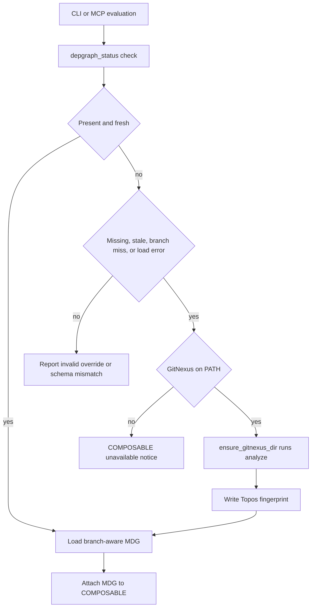
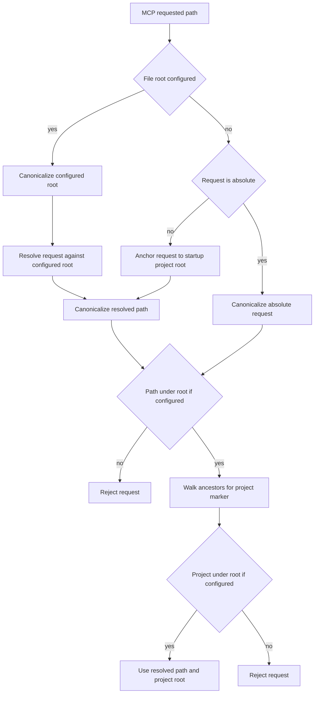
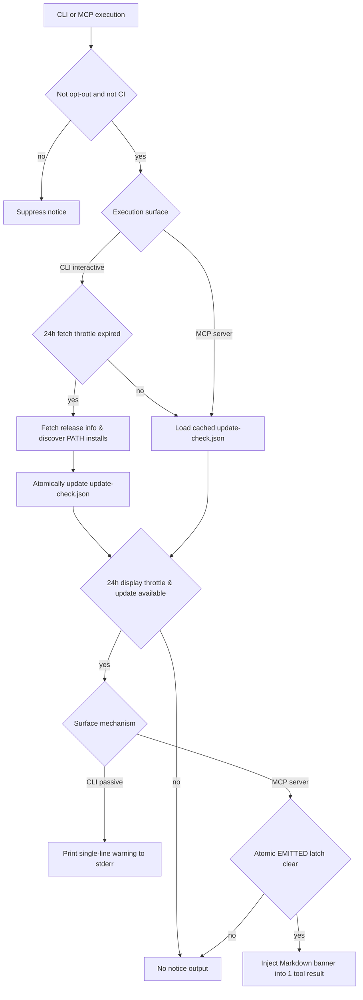

# Distribution and Integration Systems

Topos is a Rust workspace. The native `topos` CLI and the `topos-mcp` stdio server use `topos-engine`; distribution mechanisms change how a host locates, starts, confines, and updates that analyzer, not its scoring model. This page covers launch contracts, artifact channels, path security controls, packaging manifests, and update delivery mechanics across all distribution surfaces. For the core analysis pipeline, see the [architecture overview](../architecture/overview.md); for agent usage and registration workflows, see the [agent and CLI workflow](../workflows/agent-and-cli.md) and [harness registration](../workflows/harness-registration.md).

## External topology: GitNexus and the MDG

GitNexus is the optional executable behind the COMPOSABLE pillar. Both `topos depgraph generate` and MCP `topos_generate_depgraph` use the shared engine adapter, which runs `gitnexus analyze --skip-agents-md` in the selected analysis root. Topos looks for `gitnexus` on `PATH`, recognizes `1.5.0` as the minimum supported version, and pins the known-good install to `gitnexus@1.6.8`. A version newer than that pin is reported as *untested*, rather than categorically rejected, because it can still work but its store format may have drifted.

GitNexus produces `.gitnexus/`; Topos consumes it as an inter-module `ModuleDependencyGraph`, not as a replacement parser. The loader supports legacy JSON directories and current LadybugDB `lbug` stores. For a native store it discovers node tables, loads node properties, and reads `CodeRelation` edges including confidence and reason. The resulting graph supplies coupling, instability, call fan-in/out, and import-chain depth. Call fan measures symbols transitively contained by the target File through `CONTAINS`, `DEFINES`, `HAS_METHOD`, and `HAS_PROPERTY`; following `MEMBER_OF` would incorrectly cross into a community cluster.

### Generation, freshness, and recoverability

Generation records a Topos-owned `.topos-fingerprint.json` beside the resolved store (including a branch-scoped store). It captures a source-content fingerprint, file count, start/end times, and Git HEAD when available. The same discovery and ignore rules used for evaluation determine the fingerprint, so changing ignored inputs does not make COMPOSABLE stale.

Graph status inspection and resolution are handled by `depgraph_status`, which checks `.gitnexus` availability, branch store selection, store open validity (`load_error`, `branch_not_indexed`, `schema_mismatch`), and graph freshness without executing `gitnexus analyze`. Freshness evaluation evaluates anchors in strict priority order: source-content hash, Git HEAD commit SHA, the `generated_at` mtime walk across project source files, then the legacy directory mtime comparison.

The resolve-and-generate decision is standardized across both CLI (`topos evaluate`) and MCP evaluation tools through `ensure_gitnexus_dir` and `ensure_gitnexus_dir_with_progress`. The progress-aware function invokes a status closure with phase labels (such as `"Checking dependency graph freshness"` and `"Running gitnexus analyze"`) so CLI callers can drive interactive spinners while distinguishing freshness checks from generation.

By default, evaluation attempts one generation for recoverable graph states (`missing`, `stale`, `branch_not_indexed`, or `load_error`). The `--no-composable` flag / `skip` parameter restores read-only behavior and bypasses generation. If `gitnexus` is absent from `$PATH`, or if `generate_depgraph` fails, the error is handled gracefully: `cap_generation_detail` bounds child failure output to 200 bytes with an explicit elision note to avoid context window inflation, returning a structured `generation_note` while leaving SIMPLE, SECURE, and NAVIGABLE fully usable. Subprocess execution is bounded by default to 300 seconds; `TOPOS_DEPGRAPH_TIMEOUT` overrides it, and a non-positive value disables the limit. In contrast, terminal states like schema mismatches or outside-root overrides (`invalid_dir`) are not retried because subprocess generation cannot safely resolve them.

Shared graph generation and recovery decision: recoverable graph states receive one bounded generation attempt, while unsafe or schema-mismatched states do not.

### Root selection is also a containment rule

For CLI evaluation, the default graph root is the current directory. MCP file tools first detect the innermost project for the requested file, then climb to the nearest `.git` for the default GitNexus root; that avoids treating a nested `Cargo.toml` as the owner of a repository-level `.gitnexus`. The climb stops at `TOPOS_MCP_FILE_ROOT`.

An explicit `--gitnexus-dir` / `gitnexus_dir` is resolved once before deriving its parent as the generation and freshness root. Keeping that resolved value absolute prevents a relative override from being joined a second time. An existing override must canonicalize inside the MCP project boundary; an in-boundary path that has not yet been created is instead a valid first-run target.

## Sighthound is supplementary evidence, not SECURE scoring

`topos-mcp` links Sighthound at a pinned Git revision. It does not discover or execute a user-installed `sighthound` command. For Python, JavaScript, TypeScript, and Go, it runs Sighthound’s explicit scan and taint analysis in process with embedded rules, maps findings to `SecurityFinding`, applies the caller’s allowlist, and stops at the requested finding cap. It scans an actual supplied file when possible, otherwise a temporary source file. Unsupported languages, scan failure, or a non-empty `TOPOS_DISABLE_SIGHTHOUND` value other than `0` select the local CPG-probe fallback.

**The canonical SECURE verdict remains CPG-native.** Sighthound-derived `security_findings` are supplementary, advisory evidence returned with the analysis; they neither replace the SECURE score nor define its gate. Keep tests and documentation for the two layers separate: changing an embedded rule mapping can change diagnostic detail without changing the canonical SECURE classification.

For taint findings, Topos identifies the actionable callee and display sink from `sink_info.sink_type` before the containing function name. The allowlist is matched afresh against that callee, so an entry for `os.system` can suppress a matching taint sink but an entry for a surrounding `handle_request` function cannot. This avoids acknowledging the wrong operation.

## MCP server: launch and filesystem trust boundary

With no arguments, `topos-mcp` serves MCP over standard input/output until its client closes stdin; `--version` and `--help` are its only local options. The server aggregates tool routers and exposes tools, resources, and the `topos_refactor_until_ideal` prompt. It deliberately pins negotiation to MCP revisions `2024-11-05`, `2025-03-26`, `2025-06-18`, `2025-11-25`, and `2026-07-28`. The latter permits `server/discover` as the first request; the initialize and discovery paths expose the same tool surface.

Filesystem tools call `resolve_project_path`, rather than trusting the server process working directory. A requested existing file or directory is canonicalized and must be readable. When `TOPOS_MCP_FILE_ROOT` is set, the canonical root is a maximum boundary: both the resolved request and its discovered project root must remain below it. When `TOPOS_MCP_FILE_ROOT` is unset, relative requests are anchored against the startup process project root and held inside it, while absolute requests are canonicalized and checked for an ancestor project marker (`.git`, `pyproject.toml`, or `Cargo.toml`). Canonicalization failure, boundary escape, and missing project marker are errors, not fallbacks to process working directory.

MCP filesystem containment flow: canonicalizes requests and verifies that resolved paths and discovered project markers satisfy containment boundaries.

A separate resolver supports paths that may not exist yet, chiefly a graph-store override. `resolve_existing_prefix` canonicalizes every existing component; it applies a missing tail lexically, but resumes symlink resolution if `..` removes that tail. `resolve_path_within` then compares that result with the canonical root. This is why a missing leaf and paths such as `link/missing/..` cannot hide an existing symlink escape; lexical normalization alone is unsafe here.

## Registry wheels, native binaries, Docker image, and shell installer

Distribution artifacts span PyPI wheels, the MCP Server Registry manifest, platform-native binaries, a container image, and a shell installation script. All packaging manifests are synchronized to version `0.11.0`.

### Maturin PyPI packaging and MCP Registry manifest

`.mcp/server.json` declares the MCP Registry entry `io.github.Krv-Labs/topos` at version `0.11.0`: the `topos-mcp` PyPI package is launched with `uvx` using stdio transport. `pyproject.toml` packages the Rust server with Maturin `bindings = "bin"`. The wheel installs the compiled `topos-mcp` command on `PATH`; it has no Python runtime dependencies (`dependencies = []`) or Python import surface, although it declares Python `>=3.9` as its package-installation requirement.

The workspace version in `Cargo.toml` (`0.11.0`) is the authoritative version root. `scripts/check_versions.py` enforces strict version agreement across:
- Cargo workspace (`Cargo.toml`)
- VS Code extension (`extensions/vscode/package.json`)
- Agent Plugin manifest (`agent-plugin/plugin.json`)
- MCP Registry manifest (`.mcp/server.json` top-level and package entries)

The release workflow (`.github/workflows/release.yml`) running the `verify-version` job invokes `check_versions.py` and compares git release tags or workflow dispatch inputs against `Cargo.toml` (normalizing leading `v` prefixes). Additionally, `check_versions.py` enforces that PyPI registry metadata in `.mcp/server.json` omits both `registryBaseUrl` and `--index-url` runtime arguments to prevent VS Code from duplicating `--index-url` options for `uv`.

### Native release binaries and Release CI

Release CI (`.github/workflows/release.yml`) builds native `topos` binaries across target platforms (Linux amd64/arm64, macOS arm64). Before publishing, Linux builds check for unexpected dynamic linkage via `readelf`, while macOS builds verify that binaries link only system libraries via `otool`, run a `--version` smoke test, sign with Apple Developer ID certificates (enforcing hardened runtime options), run a signed library validation smoke test, and optionally notarize the archive. Staged native binaries are also packed into target-specific VSIX packages for VS Code distribution.

### Docker image architecture

The `Dockerfile` provides a two-stage Glama-oriented container build based on `python:3.12-slim`:
1. **Builder stage:** Installs Rust and Maturin, copying workspace sources and invoking `maturin build --release --bindings bin --manifest-path topos/mcp/Cargo.toml` to compile the standalone `topos-mcp` binary into a Python wheel under `/wheels`.
2. **Runtime stage:** Installs the compiled wheel via `pip`, provisions Node.js 20 and `gitnexus@1.6.8` via npm so COMPOSABLE graph analysis operates inside the container, and sets `ENTRYPOINT ["topos-mcp"]`.

Python exists in the image purely as the wheel installation substrate; the server itself runs as a compiled native binary. The container image sets `TOPOS_MCP_FILE_ROOT=/workspace` and `WORKDIR /workspace`. Mount the target repository at `/workspace` to configure filesystem trust boundaries.

### Shell installation script (`install.sh`)

The standalone shell installer (`install.sh`) provides automated binary installation via `curl -fsSL https://docs.krv.ai/topos/install.sh | bash`. Key mechanics include:
- **Installation Directory:** Places the native `topos` binary into `INSTALL_DIR` (default: `~/.local/bin`).
- **Environment Controls:** Supports `TOPOS_VERSION` (default `latest`), `TOPOS_INSTALL`, `TOPOS_NO_MODIFY_PATH` (suppresses PATH modification), `TOPOS_FORCE` / `TOPOS_YES` (bypasses interactive prompts when overwriting existing non-installer binaries), and `TOPOS_SKIP_MAIN` (for testing helper functions).
- **Preflight & Discovery:** Scans `$PATH` and standard locations (`~/.local/bin`, Homebrew prefixes) for existing `topos` executables. It classifies found binaries by installation channel (Homebrew, Python/pipx package, binary install) and prompts or warns before overwriting foreign binaries.
- **Provenance & PATH Setup:** Writes installation provenance metadata to `~/.local/state/topos/install-provenance` (respecting `XDG_STATE_HOME`). Modifies shell startup files (`.bashrc`, `.zshrc`, etc.) enclosed by `# BEGIN TOPOS INSTALLER PATH` and `# END TOPOS INSTALLER PATH` delimiters.

## Agent Plugin and VS Code surfaces

### Agent Plugin manifests

The portable Agent Plugins 1.0 package is **host-owned setup**. `agent-plugin/plugin.json` provides package metadata at version `0.11.0`; `agent-plugin/mcp.json` asks a compatible host to start `topos mcp` over stdio. Discovery, enablement, permission prompts, environment construction, and process supervision belong to that host, not to Topos.

Validation script `scripts/check_agent_plugin.py` enforces strict package boundaries:
- Validates top-level JSON fields against Agent Plugins 1.0 schemas.
- Forbids relative path traversal (`..`) in `cwd` or command paths.
- Prohibits symlinks in plugin packages (requiring regular files).
- Reserves host-supplied environment variables (`PLUGIN_ROOT`, `PLUGIN_DATA`).
- Requires pathless or plugin-relative (`./`) command formats.
- Mandates that packaged skill files are byte-for-byte regular file copies of canonical skill definitions.

The canonical skill is an instruction distribution surface, not a credential or executable installer. Its ClawHub workflow runs on skill changes and release tags, invokes a pinned external reusable workflow, and passes only the named ClawHub secret through that interface.

### VS Code extension

The workspace extension activates on startup, an MCP-server request, or either Topos command. Its declared engine is VS Code `^1.105.0`, but it feature-detects `vscode.lm.registerMcpServerDefinitionProvider` and `McpStdioServerDefinition`; without both, it does not register a server and tells the user that an MCP-capable VS Code 1.120+ or compatible host is needed. Native Windows is blocked with WSL/manual-install guidance.

When the host requests `topos-mcp`, the extension registers a stdio definition and ultimately launches `topos mcp`. It passes the first workspace folder as `TOPOS_MCP_FILE_ROOT`, connecting editor workspace selection to the MCP containment boundary. **Evaluate Project** and **Generate Dependency Graph** run the same resolved executable in a VS Code terminal; evaluation detects supported languages and runs one CLI invocation per detected language. GitNexus absence is a dismissible, non-blocking prompt because only COMPOSABLE depends on it.

Executable resolution is ordered: `topos.executablePath`, bundled target binary, verified cached binary, `PATH`, optionally an active Python environment, then optionally a remote manifest download. Every viable local candidate must run `--version`; cached/downloaded files must also match SHA-256 and are removed on failed validation. The manifest and download client accept only HTTP 200, follow at most five redirects, and use a 15-second request timeout. Consequently, integrity checking protects the binary payload, while `https://raw.githubusercontent.com/Krv-Labs/topos/main/releases.json` is an explicit trust root for the selected URL and checksum.

## Plugin and skill surfaces versus CLI harness registration

The portable Agent Plugins 1.0 package is host-owned setup, whereas **CLI-owned harness registration** is driven by `topos install`, `topos uninstall`, and `topos status`.

`topos install` writes or inspects one `topos` MCP entry in selected user harness configuration files. The intended entry uses the resolved absolute `topos` command with exactly `args: ["mcp"]`; the format adapter uses `mcpServers`, `mcp_servers`, or VS Code’s `servers` and adds `type: "stdio"` only for VS Code JSONC. It does not install skills, author instruction files, or take ownership of other entries. Existing foreign/conflicting entries are reported and preserved; an owned but stale command is repairable. Uninstall removes only the owned registration and deletes an emptied configuration file only when its ownership ledger records that install created it.

`pi` is the narrow exception: it lacks an MCP client unless the user separately installs `pi-mcp-adapter`. If a Topos skill already exists in a known external skill directory, `topos install pi` may append that directory path to pi’s `settings.json` `skills` array; it never writes the skill content. If pi already discovers the skill or no skill is installed, it writes no reference. This preserves the ownership boundary even where a harness needs two integration artifacts.

## Update check mechanism and release notice delivery

Topos incorporates a unified self-update discovery and notice architecture shared between the `topos` CLI and `topos-mcp` server inside `topos/mcp/src/update/`. Because `topos/cli` depends on `topos-mcp`, both surfaces query available releases, inspect installed binary channels, and deliver update notifications using common data structures without duplicate network or parsing logic.

Unprompted update checks and notices are governed by three independent safety controls:
1. **Opt-Out & CI Gate:** Checks are disabled if `TOPOS_NO_UPDATE_NOTICES` is set or if running in CI environments (`CI` or `GH_PROMPT_DISABLED`).
2. **Fetch Throttle:** Network release queries are rate-limited to at most once per 24 hours (`THROTTLE_SECS = 86400`). Cached release metadata is stored in `update-check.json` within the user state directory. Atomic file replacement via temporary file staging prevents concurrent processes from reading partial JSON data.
3. **Display Throttle:** Update notices are displayed at most once per 24 hours (`notified_at`), tracked independently from fetch timestamps so fresh background checks do not reset quiet periods. `claim_notice` claims display rights atomically across processes.

Update check, throttle, and notice delivery workflow across CLI and MCP execution surfaces.

### Surface-specific delivery mechanics

Notice delivery behavior adapts to the execution context:
- **CLI passive notices:** On interactive commands where standard input, output, and error streams are terminals (`interactive()`), `passive_notice()` invokes `refresh(&home)` to perform the network fetch when stale. If an update is available or shadowed binaries exist, it prints a single-line advisory to `stderr` so machine-readable `stdout` outputs (such as `--json`) are preserved. Notice delivery is explicitly suppressed for `topos update` and `topos mcp`.
- **MCP server notice injection:** The stdio `topos-mcp` server **never initiates network checks** during tool execution to guarantee fast, deterministic response times. Instead, it reads the cache file populated by previous CLI runs. When an update is available and display throttle permits, an in-memory `EMITTED` atomic boolean latch ensures that a Markdown update banner is injected into at most **one** tool execution response per server process lifecycle.
- **Shadowed installation discovery:** `Survey` discovers all `topos` executables across `$PATH` (`installs::discover`). When multiple binaries are found, it detects shadowed installs where $PATH ordering causes a different binary to run, warning the user when an upgrade might appear ineffective.

`topos update` performs direct channel-aware upgrades or downloads signed, checksum-verified native release binaries from official release assets.

## Focused checks when changing a boundary

- **GitNexus and MDG:** test version classification, branch-store selection, fresh/stale and first-run overrides, containment relationships used for fan metrics, and timeout/failed subprocess behavior. `cargo test -p topos-engine gitnexus` is a focused starting point.
- **MCP containment and lifecycle:** run `cargo test -p topos-mcp security` and lifecycle tests. Keep regressions for missing in-root leaves and direct or `..`-mediated symlink escapes, and exercise both initialize and `server/discover` protocol eras.
- **Sighthound:** test supported-language mapping, disable/fallback behavior, cap and allowlist handling, and taint sink selection independently from canonical CPG SECURE tests.
- **Distribution metadata:** run `python3 scripts/check_versions.py` and `python3 scripts/check_agent_plugin.py`. A version or registry metadata change should also be checked through the release workflow’s platform/linkage paths.
- **VS Code:** run `pnpm run test` in `extensions/vscode`. Its unit tests cover invocation formation, language detection, SHA-256, manifest selection, redirects, non-200 responses, and timeout behavior without reaching the network.
- **Harness changes:** use `topos/cli/tests/install_e2e.rs` plus dry-run, conflict, repair, and uninstall scenarios. Do not merge a convenience change that lets harness registration overwrite a user-owned entry or install skill contents.
- **Update checks and notices:** run `cargo test -p topos-cli update_e2e` to verify survey reporting, cached throttle handling, shadowed binary detection, and offline behavior.
