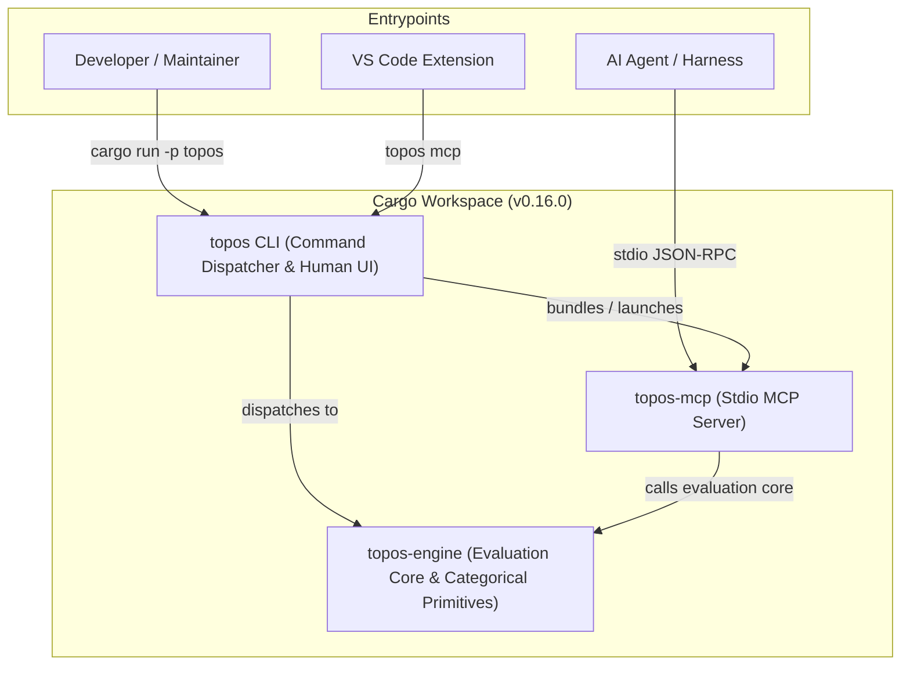
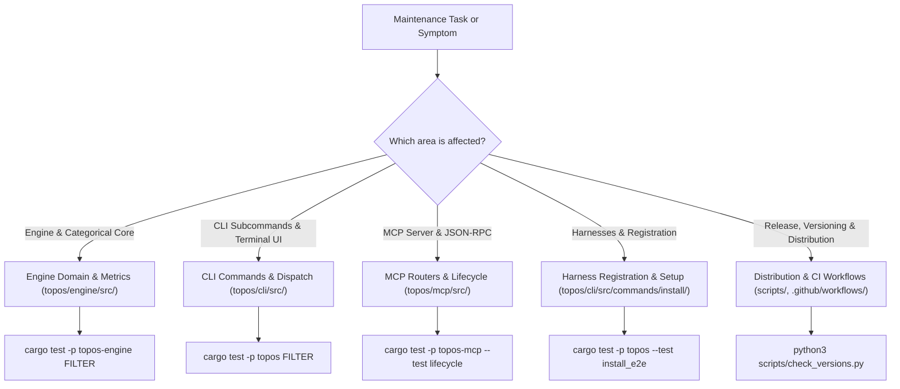

# Quickstart Guide

Topos is a three-crate Cargo workspace: `topos-engine` owns shared structural analysis, categorical model representations, and quality classification; `topos` provides the human CLI interface and command dispatch; and `topos-mcp` implements the stdio Model Context Protocol (MCP) server. Keep domain policy and structural analysis in the engine crate. The CLI and MCP crates wrap engine capabilities into their respective transport interfaces; `topos mcp` launches the same in-process MCP server implementation exposed by the standalone `topos-mcp` binary crate.

Source code and tests are primary authority. Use this quickstart guide to onboard immediately, route maintenance tasks across the repository, apply AI agent interaction guidelines, run targeted verification workflows, and navigate the OpenWiki documentation suite.

## Workspace Architecture

The root [`Cargo.toml`](../Cargo.toml) defines the workspace package version (`0.16.0`) and contains three member crates (`members = ["topos/engine", "topos/cli", "topos/mcp"]`):

- **`topos-engine`**: Shared pure-Rust analysis core containing configuration (`.topos.toml`), categorical primitives (`core`), AST/CFG/CPG/PDG/MDG/UAST representations (`graphs`), metrics and curvature functors (`functors`), quality policy evaluation (`evaluation`), and subprocess/filesystem edge adapters (`adapters`). It excludes CLI and MCP transport concerns.
- **`topos`**: Standalone CLI binary (`src/main.rs`) dispatching 14 root subcommands: `evaluate`, `inspect`, `pr-recap`, `config`, `compare`, `coverage`, `badge`, `depgraph`, `cache`, `install`, `uninstall`, `update`, `status`, and `mcp`. On failure, commands print an error message to `stderr` and exit with status 1.
- **`topos-mcp`**: Stdio MCP server combining evaluate, assess, compare, coverage, dependency-graph, documentation, inspection, preferences, pr-recap, and refactor tool routers, embedded documentation resources (`topos://docs/*`), build identity resource (`topos://build`), and the `topos_refactor_until_ideal` prompt.


*Topos workspace crate topology, entrypoints, and communication channels.*

## Onboarding and Verification Workflows

From a clean repository checkout, verify the CLI binary and run a baseline evaluation that disables automatic GitNexus background graph generation:

```bash
cargo run -p topos -- --help
cargo run -p topos -- evaluate . -r --no-composable
```

Use the narrowest relevant test command during development, then expand validation before committing or submitting a pull request:

```bash
# Code formatting and linting
cargo fmt --all --check
cargo clippy --workspace --all-targets -- -D warnings

# Unit and integration test suites
cargo test --workspace

# Focused crate and test suite targets
cargo test -p topos-engine <filter>
cargo test -p topos <filter>
cargo test -p topos-mcp --test lifecycle
cargo test -p topos --test install_e2e
```

### Python Validation Scripts

For workspace versioning, agent skill definitions, or plugin manifest changes, run the Python verification scripts:

```bash
python3 scripts/check_versions.py
python3 scripts/check_skill.py
python3 scripts/check_agent_plugin.py
```

- **[`scripts/check_versions.py`](../scripts/check_versions.py)**: Reads the Cargo workspace version (`0.16.0`) from `Cargo.toml` and enforces exact version matching across `extensions/vscode/package.json`, `agent-plugin/plugin.json`, `.mcp/server.json`, and `.mcp/server.json` package arrays. When called with `--tag <tag>`, it normalizes the release git tag (stripping a leading `v`) and verifies it equals the workspace version.
- **[`scripts/check_skill.py`](../scripts/check_skill.py)**: Validates bundled agent skills under `skills/`, checking frontmatter requirements, name matching, description length caps, required sections, and metadata schemas.
- **[`scripts/check_agent_plugin.py`](../scripts/check_agent_plugin.py)**: Validates Agent Plugins 1.0 specifications under `agent-plugin/`, ensuring valid schema URIs, non-symlink manifest structures, command paths, and environment variable bounds.

## Task-Based Routing Map

When undertaking maintenance tasks across the Topos codebase, use the routing diagram and table below to identify primary wiki documentation, starting source directories, and focused verification proof commands.


*Task routing flowchart linking system layers to primary source paths and focused verification commands.*

| Task or Symptom | Read First | Start Location | Focused Proof |
| --- | --- | --- | --- |
| Pillars (`SIMPLE`, `COMPOSABLE`, `SECURE`, `NAVIGABLE`), gate decisions, thresholds, suppressions, preferences | [Quality Model & Categorical Engine](domain/quality-model.md) | `topos/engine/src/evaluation/`, `topos/engine/src/core/` | `cargo test -p topos-engine <filter>` |
| Structural views (AST, UAST, CFG, PDG, CPG, MDG), graph metrics, categorical functors, curvature | [Architecture Overview](architecture/overview.md) | `topos/engine/src/graphs/`, `topos/engine/src/functors/` | `cargo test -p topos-engine <filter>` |
| CLI subcommands (`evaluate`, `inspect`, `pr-recap`, `config`, `compare`, `coverage`, `badge`, `depgraph`, `cache`, `install`, `uninstall`, `update`, `status`, `mcp`), terminal UI, JSON output | [Agent and CLI Workflows](workflows/agent-and-cli.md) | `topos/cli/src/main.rs`, `topos/cli/src/commands/` | `cargo test -p topos <filter>` and `cargo run -p topos -- <cmd> --help` |
| MCP tools, JSON-RPC schemas, resources, prompts, stdio transport lifecycle, MCP protocol versions | [Agent and CLI Workflows](workflows/agent-and-cli.md) | `topos/mcp/src/main.rs`, `topos/mcp/src/server.rs` | `cargo test -p topos-mcp --test lifecycle` |
| Agent harness registration (`install`, `uninstall`, `status`), harness configs (`~/.claude.json`, Codex TOML, Gemini settings), clean-home residue | [Harness & Plugin Registration Workflow](workflows/harness-registration.md) | `topos/cli/src/commands/install/` | `cargo test -p topos --test install_e2e` |
| GitNexus (`.gitnexus` store), distribution channels (`install.sh`, Homebrew, Cargo, Python wheel, VS Code VSIX, agent skills/plugins), updates | [Distribution and Integration Systems](integrations/distribution.md) | `topos/engine/src/adapters/gitnexus.rs`, `topos/cli/src/commands/update/`, `install.sh` | `python3 scripts/check_skill.py` and channel-specific checks |
| CI pipelines, release packaging, version consistency, release tags, publishing workflows | [Verification, Testing, and Release Operations](operations/testing-and-release.md) | `.github/workflows/`, `scripts/check_versions.py` | `python3 scripts/check_versions.py` |
| Codebase directory structure, cross-crate module layout, script locations, crate ownership | [Source Code Map & Module Guide](source-map.md) | Target source file named in the map | Relevant crate or module unit tests |

## Agent Interaction Guidelines

When operating as an AI agent or maintainer in the Topos repository, adhere to the directives defined in [`AGENTS.md`](../AGENTS.md):

- **Just-in-Time Documentation Retrieval**: Do not enumerate, preload, or search wikis at task start. Retrieve documentation only when explicitly requested or when unfamiliar architecture materially impacts the task. If MCP retrieval tools are unavailable, read `quickstart.md` and follow relative links.
- **Authoritative Sources**: Source code and test suites are primary authority. Briefs or documentation review notes represent verification gaps, not automatic implementation requirements.
- **Quiet, Targeted Validation**: Use the narrowest quiet validation command that proves the changed behavior. Always preserve complete failure output when tests fail.
- **Skill and Plugin Parity**: Keep versions and definitions synchronized across `skills/topos/SKILL.md`, `agent-plugin/`, `.mcp/server.json`, `extensions/vscode/package.json`, and `Cargo.toml`. Validate changes using `python3 scripts/check_versions.py`, `python3 scripts/check_skill.py`, and `python3 scripts/check_agent_plugin.py`.
- **OpenWiki CI Policy**: The `.github/workflows/openwiki.yml` pipeline regenerates engineering documentation from source on `main` branch pushes or manual dispatch, submitting documentation PRs without modifying workflow files directly.
- **Embedded MCP Docs vs Workspace Wiki**: Embedded MCP resources (`topos_get_doc` / `topos://docs/*`) serve six focused runtime topics (`agent-contract`, `lattice`, `metrics`, `preferences`, `priority`, `workflows`). Broader workspace engineering guides live under `openwiki/` on the filesystem and are read directly by agents with repository access.

## Update Mechanics and Command Options

The `topos update` command inspects the binary's installation channel and reports available upgrades:

- **Distribution Channels**: Detects whether the running binary was installed via binary download (`install.sh`), Homebrew (`brew install krv-labs/tap/topos`), Cargo (`cargo install`), or source checkout (`cargo build`).
- **Command Options**:
  - `topos update --check`: Reports installed vs published versions without making changes or prompting. Implied in non-terminal environments.
  - `topos update --yes` (`-y`): Applies channel-specific upgrades non-interactively without confirmation prompts.
  - `topos update --json`: Emits the update survey as machine-readable JSON.
- **Passive Notices & Throttling**: Interactive CLI invocations execute a throttled passive update check at most once every 24 hours, caching results in `~/.local/state/topos`. Set `TOPOS_NO_UPDATE_NOTICES=1` to silence passive update notices completely.

## High-Value Engineering Invariants

- **Classification Belongs in the Engine**: Quality evaluations, metric scores, and gate verdicts MUST be computed within `topos-engine`. Never override or patch quality verdicts in CLI renderers or MCP formatters.
- **Scores Are Not Gate Verdicts**: Quality metrics yield normalized float scores, but gate decisions (`SIMPLE`, `COMPOSABLE`, `SECURE`, `NAVIGABLE`) are Heyting algebra elements evaluated against project priority thresholds.
- **COMPOSABLE Graph Independence**: `COMPOSABLE` uses GitNexus module graphs. If GitNexus is uninstalled or graph generation fails, standard evaluation continues operating on `SIMPLE`, `SECURE`, and `NAVIGABLE` pillars. Shared adapter generation in `topos/engine/src/adapters/gitnexus.rs` shells out to `gitnexus analyze`, writes a BLAKE2b source fingerprint (`.topos-fingerprint.json`) into the `.gitnexus` store, and pins version `1.6.8` as known to work.
- **MCP Wire Safety**: `topos-mcp` explicitly bounds protocol version support (`2024-11-05`, `2025-03-26`, `2025-06-18`, `2025-11-25`, `2026-07-28`) rather than inheriting `rmcp` defaults. Changing protocol support is a wire-contract change. Always run `cargo test -p topos-mcp --test lifecycle` to test JSON-RPC initialize, tool listing, and tool calls.
- **Harness Clean-Up Invariants**: `topos install` and `topos uninstall` must preserve non-Topos configuration entries in `~/.claude.json`, Codex TOML, and Gemini settings. Running `cargo test -p topos --test install_e2e` exercises the CLI binary against a scratch `$HOME` to verify that installation and uninstallation leave no unwanted residue.
