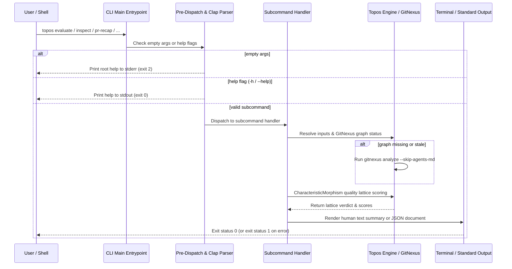
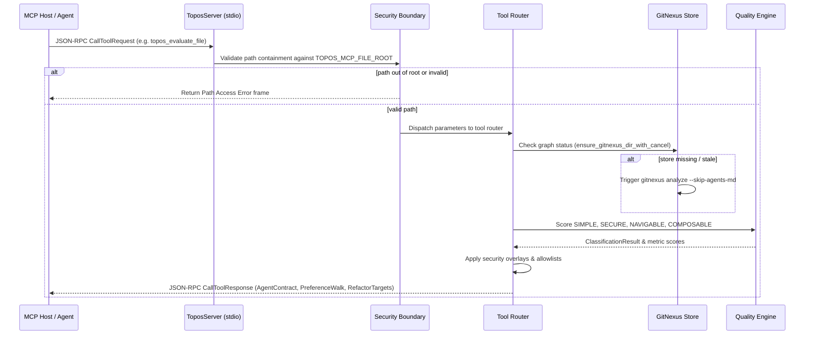
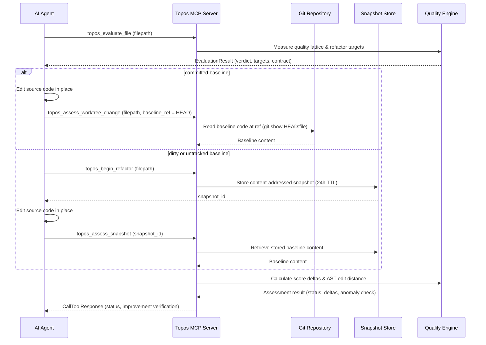

# Agent and CLI Workflows

Topos provides the `topos` CLI for local terminal operations and the stdio `topos-mcp` server for Model Context Protocol (MCP) hosts and autonomous AI agents. Both interfaces invoke the same underlying quality engine in `topos-engine`, but operate under distinct interaction contracts: CLI output is formatted for human terminal display or shell scripting, whereas MCP tool definitions, JSON schemas, result structures, tool annotations, protocol revisions, and filesystem containment boundaries constitute public contracts for external agents. Quality lattice verdicts are defined in the [Quality Model](../domain/quality-model.md); structural test coverage and advisory refactoring hotspot analysis operate as complementary architectural signals outside the four-pillar lattice.

## Command Invocation and Dispatch Architecture

While CLI commands run ephemerally from shell arguments and write formatted human text or JSON documents directly to standard streams, MCP tool calls run over a long-lived JSON-RPC stdio connection with strict security containment checks and standardized response structures.


*Sequence diagram for Topos CLI command dispatch: pre-dispatch check, clap parsing, subcommand handler execution, GitNexus graph resolution, quality engine scoring, and terminal output rendering.*


*Sequence diagram for MCP tool request execution: JSON-RPC request parsing, security path boundary enforcement, tool router dispatch, COMPOSABLE store handling, engine scoring, security overlay application, and structured response construction.*

## Human CLI Commands and MCP Tool Counterparts

The root `topos` executable dispatches fourteen subcommands. Subcommand dispatch logic intercepts empty argument lists and lone `-h`/`--help` flags before clap parsing: an empty invocation prints root help to standard error and exits with status 2, while explicit help prints to standard output and exits with status 0. Handlers report execution errors as `Error: ...` and exit with status 1.

The table below maps human CLI commands to their MCP tool counterparts:

| Domain Workflow | Human CLI Command | MCP Tool Counterpart | Primary Responsibilities & Execution Mode |
| --- | --- | --- | --- |
| Single/Multi File Evaluation | `topos evaluate PATH... [flags]` | `topos_evaluate_file`, `topos_evaluate_project`, `topos_evaluate_code` | Scores quality lattice pillars (SIMPLE, SECURE, NAVIGABLE, and COMPOSABLE if graph available). Emits terminal summary/details or JSON document. |
| Single File Inspection | `topos inspect FILE [flags]` | `topos_inspect_code` | Provides function-level metrics, UAST representation, line-level targets, and remediation guidance for a single source target or snippet. |
| Pull Request / Range Recap | `topos pr-recap RANGE_OR_PR [flags]` | `topos_pr_recap` | Computes structural diff ledger between base and head commits, detects split clusters, applies PR gate policies (`relaxed`, `recommended`, `strict`), and produces terminal cards or Markdown review comments. |
| Structural Test Coverage | `topos coverage PATH...` | `topos_calculate_coverage` | Matches UAST declarations and k-gram call paths against test files without executing test code, operating outside the quality lattice. |
| Dependency Graph Management | `topos depgraph generate [PATH]`, `topos depgraph status` | `topos_depgraph_status` (read-only), `topos_generate_depgraph` (side-effecting) | Generates, refreshes, or verifies the GitNexus Module Dependency Graph (MDG) required for COMPOSABLE scoring. |
| Structural AST Comparison | `topos compare PATH1 PATH2` | `topos_compare_files`, `topos_compare_revisions` | Calculates tree edit distance, operation breakdown, and structural similarity percentage between two source files or Git revisions. |

`topos mcp` creates a multi-threaded Tokio runtime and delegates directly to `topos_mcp::server::serve`, sharing the exact serving implementation as `topos-mcp`. Harness installation, removal, and status management are separate operational workflows; see [Harness Registration](harness-registration.md).

### Positional Input Target and Discovery Filter Resolution

`topos evaluate` accepts one or more files or directories as positional targets. Directory discovery descends into subdirectories only when `-r`/`--recursive` is supplied. The `--language` flag filters discovery targets:

- **Without `--language`**: Topos recursively discovers all supported file extensions (`.py`, `.rs`, `.js`, `.ts`, `.cpp`, `.go`) and infers language per file.
- **With `--language LANGUAGE`**: Topos validates the language name and restricts directory discovery strictly to extensions associated with that language.
- **Explicit file targets**: Explicit file arguments are never silently omitted. Passing an unsupported file type or a file that conflicts with an active `--language` filter fails immediately with an explicit error detailing the mismatch.
- **Empty directories**: Evaluating an empty directory succeeds; text mode notes that no supported files were found (and suggests `-r` if omitted), while `--json` emits an empty project evaluation result.

Output flags operate independently of discovery: `--json` cannot be combined with `--info` or `--failures PILLAR`. `--verbose` prints per-file classifications and raw metrics, `--info` highlights actionable line details for weak files, and `--failures` targets files failing a designated pillar. `--priority` accepts a single pillar name or a comma-separated ranking (e.g. `simple,composable,secure,navigable`).

```bash
# Discover all supported languages recursively under src/
topos evaluate src/ -r

# Limit directory discovery to Python files
topos evaluate services/ -r --language python

# Explicit mismatch error if file language conflicts with filter
topos evaluate src/main.rs --language python
```

### COMPOSABLE Preparation and GitNexus Integration Policy

COMPOSABLE scoring relies on a GitNexus Module Dependency Graph (MDG); SIMPLE, SECURE, and NAVIGABLE do not. Unless `--no-composable` or `no_composable: true` is passed, CLI commands and filesystem MCP tools execute `ensure_gitnexus_dir` (or its cancellation-aware variant `ensure_gitnexus_dir_with_cancel`) to inspect graph store state. If store state is `missing`, `stale`, `branch_not_indexed`, or `load_error`, Topos attempts to auto-generate or refresh the store by running `gitnexus analyze --skip-agents-md`.

Subprocess execution during store generation is bounded by `TOPOS_DEPGRAPH_TIMEOUT` (300 seconds by default). If `gitnexus` is missing from `$PATH`, generation fails, or a schema mismatch occurs, Topos gracefully degrades evaluation: SIMPLE, SECURE, and NAVIGABLE pillars are scored normally, COMPOSABLE is marked as not measured, and a top-level notice explains why graph analysis was omitted.

`topos depgraph generate` provides the explicit, strict graph generation entrypoint. It no-ops if a fresh graph exists (`present`) unless `--force` is supplied and refuses a schema-mismatched store (`schema_mismatch`) rather than overwriting it. In MCP contexts, `topos_depgraph_status` is read-only (`read_only_hint = true`), whereas `topos_generate_depgraph` is its side-effecting counterpart (`read_only_hint = false`).

### Store Location and Project Root Resolution

For CLI invocations, the default graph root is the Git repository root containing the current working directory. Passing `--gitnexus-dir <PATH>` or `gitnexus_dir` sets the store location and establishes its parent directory as the COMPOSABLE project root (`resolve_composable_project_root`). Relative override paths are resolved against the default root exactly once via `resolve_override_for_root` before reuse to avoid relative-path double-joining when deriving child roots.

In MCP contexts, file paths determine the detected project root (searching upward for `.git`, `pyproject.toml`, or `Cargo.toml`). `resolve_mcp_composable_project_root` ensures that if an explicit `gitnexus_dir` override would place the derived project root outside the trusted `TOPOS_MCP_FILE_ROOT` boundary, the resolver falls back to the trusted file root, preventing store path escape. An override inside the root that has not been created yet represents a first-run `missing` state and triggers auto-generation; symlink escapes or paths outside the root fail closed as invalid overrides.

### Security Diagnostic Overlays and Risk Allowlists

Security findings are generated when CPG or CFG analyses detect dangerous call patterns or untrusted data flows. When evaluating files, security diagnostic overlays classify findings into active risks and acknowledged risks based on the caller-supplied `allow` vector (e.g. `allow: ["exec", "eval"]`). Active findings gate the SECURE pillar, whereas acknowledged risks are retained in the response payload for explicit audit transparency without degrading the SECURE score.

## MCP Protocol Lifecycle and Trust Boundaries

The stdio `ToposServer` aggregates ten tool routers (`evaluate`, `inspect`, `pr_recap`, `coverage`, `depgraph`, `compare`, `assess`, `refactor`, `preferences`, and `docs`). It advertises tools, resources (`topos://docs/<slug>` and `topos://build`), prompts (`topos_refactor_until_ideal`), and task capabilities.

<!-- openwiki: mermaid parse failed and this diagram was converted to a text fence so it does not break rendering. Fix the diagram source and restore the mermaid fence. Parser error: Heuristic: an unescaped angle bracket inside a label breaks rendering; rephrase the label. -->
```text
sequenceDiagram
    participant Host as MCP Host
    participant Server as ToposServer
    alt initialize era (protocol <= 2025-11-25)
        Host->>Server: initialize (protocol version)
        Server-->>Host: negotiated version & capabilities
        Host->>Server: notifications/initialized
    else stateless era (protocol 2026-07-28)
        Host->>Server: server/discover (with request metadata)
        Server-->>Host: capabilities, instructions & version
    end
    Host->>Server: tools/list or tools/call
    Server-->>Host: Tool surface & JSON-RPC response
```
*MCP protocol initialization and discovery lifecycles for initialize-era and stateless connection flows.*

Topos explicitly supports MCP protocol revisions from `2024-11-05` through `2026-07-28`. Initialize-era hosts send `initialize` followed by `notifications/initialized`. Protocol `2026-07-28` clients issue `server/discover` and supply client capabilities and protocol revision per request via `_meta`. Integration tests in `topos/mcp/tests/lifecycle.rs` send raw stdio JSON-RPC frames to verify protocol parity across connection flows.

### Filesystem Containment Boundaries

Every filesystem MCP tool canonicalizes target file paths prior to reading. When `TOPOS_MCP_FILE_ROOT` is set, it establishes an absolute maximum containment boundary. Callers must supply absolute file paths or relative paths that resolve strictly within this root.

Project context is resolved by identifying the nearest ancestor directory containing `.git`, `pyproject.toml`, or `Cargo.toml`. Target paths located outside the trusted boundary, symlink escapes, or directory trees missing project markers fail closed and return path access errors.

## AI Agent Tool Calling Patterns and Context Budgeting

Autonomous AI agents interact with Topos tools using flat parameter schemas without nested `params` wrappers. To operate effectively within LLM context windows, Topos structures responses to provide compact loop guidance and configurable response detail.

### Response Formatting, Pagination, and Cache Controls

Project-wide evaluations can generate large result sets. `topos_evaluate_project` provides explicit parameters to budget context consumption:

- **`detail`**: Accepts `"summary"` (default) to return top-level aggregate floor verdicts, language rollups, and worst files, or `"full"` to return per-file evaluation rows.
- **`limit` and `offset`**: Controls page sizes (clamped between 1 and 500, default 25) and enables zero-based pagination via returned `next_offset` values.
- **`include_security_findings`**: Opts in to attaching full security diagnostic findings to file entries.
- **Static Discovery Caching**: Static discovery endpoints (`tools/list`, `prompts/list`, `resources/list`, `resources/templates/list`, and `topos://docs/*`) specify `ttlMs = 86400000` (24 hours) with `cacheScope = "public"` to enable client-side caching.
- **Dynamic Resource Handling**: Process-specific diagnostic resources like `topos://build` specify `ttlMs = 0` and `cacheScope = "private"` to prevent stale build metadata reuse.

```json
{
  "jsonrpc": "2.0",
  "id": 1,
  "method": "tools/call",
  "params": {
    "name": "topos_evaluate_project",
    "arguments": {
      "path": "/project/src",
      "detail": "full",
      "limit": 10,
      "offset": 0,
      "verbose": false
    }
  }
}
```

### Structured Loop Guidance: AgentContract, PreferenceWalk, and RefactorTarget

Evaluation responses embed structured metadata packets that guide agent loop decisions without extra LLM reasoning cycles:

1. **`AgentContract`**: Supplies next-step loop instructions:
   - `next_tool`: Recommended next MCP tool to execute (e.g. `"topos_inspect_code"`, `"topos_assess_worktree_change"`).
   - `next_actions`: Array of actionable next steps.
   - `blocked_by`: Flags preventing advancement (e.g. `["parse_failures"]`, `["composable_unavailable"]`).
   - `verification_gates`: Array of gate checks required before completing the loop.
   - `risk_flags`: Active risk indicators (e.g. `["active_security_findings"]`).

2. **`PreferenceWalk`**: Materializes user pillar ranking preferences:
   - `ranking`: Ordered pillar list (e.g. `["secure", "simple", "composable", "navigable"]`).
   - `target`: Aspirational target verdict (e.g. `"IDEAL"`).
   - `fallback_target`: Acceptable fallback target verdict.
   - `walk`: Sequence of intermediate lattice steps toward target.
   - `next_step`: Recommended next lattice step.
   - `next_pillar`: Closest failing pillar gate in priority order.
   - `progress`: Floating-point completion ratio (0.0 to 1.0).

3. **`RefactorTarget`**: Provides prioritized line-level refactoring targets:
   - `target_id`, `kind` (`"function"`, `"module"`, `"security_call"`), `filepath`, `symbol`, `line_start`, `line_end`.
   - `severity`: Marked as `"fix"` when gating pillar `achieved` status, or `"improve"` when advisory. Gating targets are ordered first.
   - `metric`, `current_value`, `threshold`, `recommended_operations`, and `constraints`.

## Refactoring Workflows and Prompt Engineering

Topos provides built-in prompt engineering and content-addressed baseline tracking to execute reliable evaluate-edit-assess refactoring loops.

### Autonomous Refactoring Prompt (`topos_refactor_until_ideal`)

The `topos_refactor_until_ideal` MCP prompt returns a structured prompt template for agent orchestration. It takes the following arguments:

- `filepath` (required string): Target source file path to refactor.
- `priority` (optional string): Primary pillar priority (`"simple"`, `"composable"`, `"secure"`, `"navigable"`; default `"secure"`).
- `max_iterations` (optional integer): Maximum iteration budget (default `5`).
- `ranking` (optional array of strings): Custom pillar ranking preference list.

The prompt instructs the agent to measure initial quality via `topos_evaluate_file`, inspect target functions via `topos_inspect_code`, execute source edits, and verify structural improvements using worktree or snapshot assessment tools until reaching `IDEAL` or exhausting the iteration budget.

### Baseline-Aware Evaluate-Edit-Assess Loop

Iterative code refactoring requires establishing a baseline *before* modifying source files. Committed baselines are read directly from Git, while uncommitted or untracked pre-edit states use content-addressed snapshots.


*Baseline-aware evaluate-edit-assess loop using Git reference comparisons (`topos_assess_worktree_change`) or content-addressed snapshot tracking (`topos_begin_refactor` and `topos_assess_snapshot`).*

1. **Initial Evaluation**: Invoke `topos_evaluate_file` or `topos_inspect_code` to classify initial quality lattice scores, retrieve `AgentContract` recommendations, and extract line-level `RefactorTarget` locations.
2. **Committed Baseline Assessment (`topos_assess_worktree_change`)**: For files committed in Git, make edits in place and call `topos_assess_worktree_change` with `filepath` and optional `baseline_ref` (default `"HEAD"`). The tool reads `<ref>:<path>` via Git; dash-prefixed refs are rejected to prevent flag injection.
3. **Dirty/Untracked Baseline Assessment (`topos_begin_refactor` & `topos_assess_snapshot`)**: For uncommitted or untracked files, call `topos_begin_refactor` before editing. Topos creates a content-addressed snapshot in `TOPOS_SNAPSHOT_DIR` (or temporary storage). Snapshots survive server restarts, expire after 24 hours, and bind to the file path. After editing, pass the returned `snapshot_id` to `topos_assess_snapshot`.
4. **Side-by-Side & Multi-File Variant Assessments**: Use `topos_assess_improvement` for explicit side-by-side variants (accepting `filepath`/`current_code` vs `proposed_filepath`/`proposed_code`). Use `topos_assess_changeset` for multi-file Git diff assessments.

### Assessment Outcomes and Metric Gaming Detection

Assessment tools evaluate structural changes between baseline and edited versions, computing score deltas, pillar status shifts, and normalized AST edit distance.

If normalized AST edit distance is below `0.02` while any score delta magnitude is at least `3.0`, Topos flags the result with `SUSPICIOUS_NO_STRUCTURAL_CHANGE`. This anomaly flag highlights potential metric gaming or scoring instability where numerical metrics shifted without substantive AST structural modifications. Agents must only accept refactor iterations when status is `IMPROVEMENT` or `IMPROVEMENT_SCORE` without suspicious flags, active SECURE findings are fixed or explicitly acknowledged, and behavior test suites pass.

## Contract Evolution, Verification, and Testing

Changes to MCP tool definitions, descriptions, JSON schemas, tool annotations, or protocol handlers affect external host integration. When introducing a new tool, implement its router with `#[tool_router]`, register it in `ToposServer::new`, and verify tool listing and call handling in integration tests.

Run target test suites during development and release verification:

```bash
cargo test -p topos
cargo test -p topos-mcp
cargo test -p topos-mcp --test lifecycle
```

- **CLI Test Suites**: Verify multi-language discovery, `--language` filter validation, missing path reporting, and empty directory success handling.
- **Snapshot Test Suites**: Confirm content-addressed storage persistence, path binding, and 24-hour expiration lifecycle.
- **Security Test Suites**: Verify containment boundary enforcement (`TOPOS_MCP_FILE_ROOT`), path canonicalization, and symlink escape rejection.
- **MCP Lifecycle Integration Tests**: Validate stdio protocol negotiation and tool surface parity across `2025-11-25` initialize-era and `2026-07-28` stateless `server/discover` flows.

For operational deployment and harness setup, see [Harness Registration](harness-registration.md) and [Architecture Overview](../architecture/overview.md).
