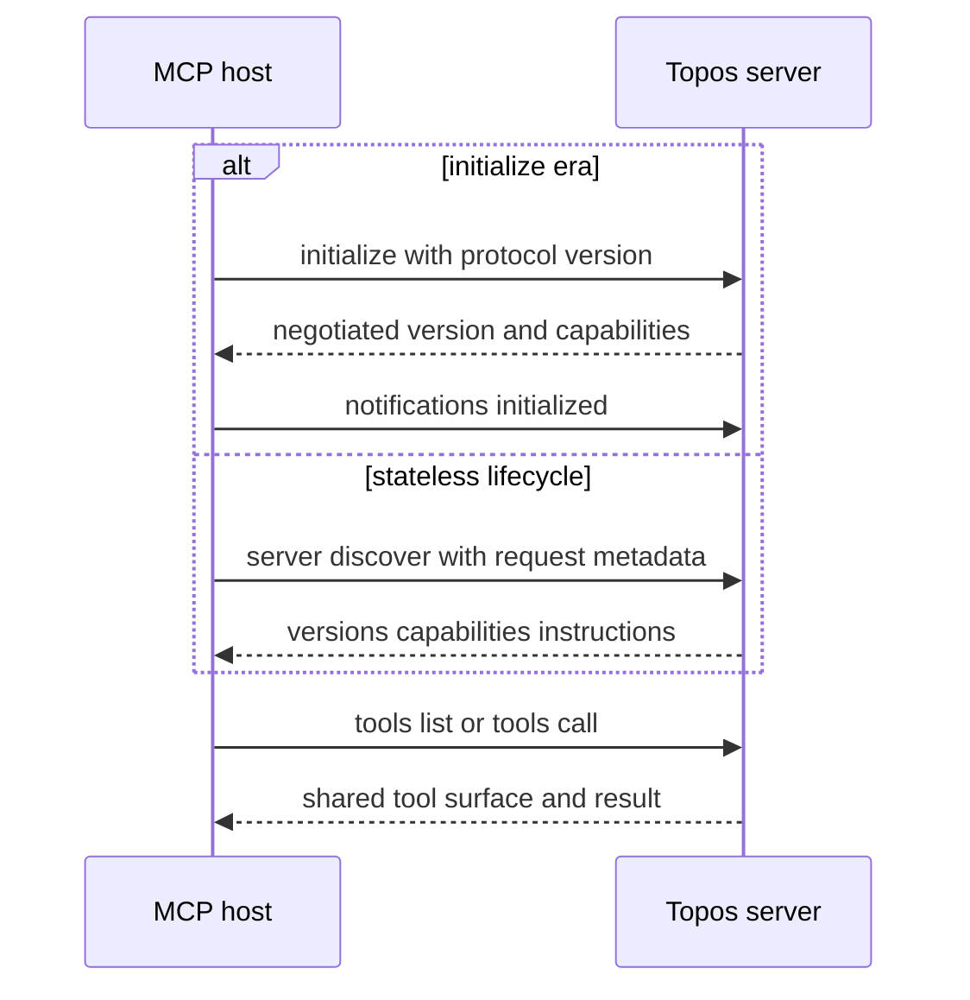
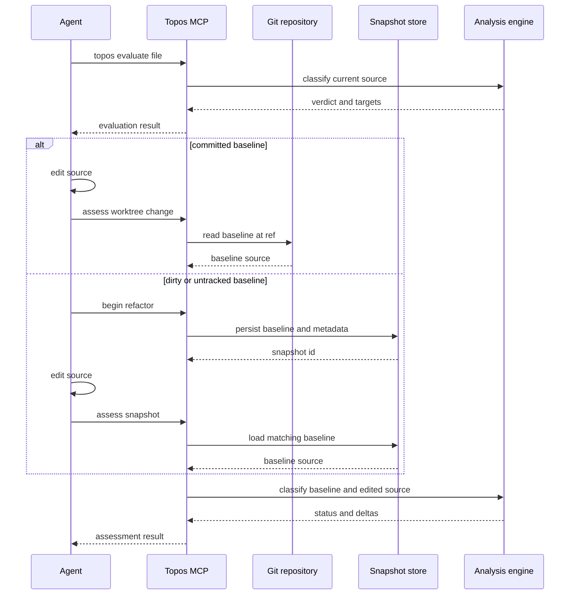

# Agent and CLI Workflows

Topos provides the `topos` CLI for local terminal operations and the stdio `topos-mcp` server for MCP hosts and autonomous agents. Both interfaces invoke the same underlying quality engine, but operate under distinct interaction and safety contracts: CLI output is formatted for human terminal display or shell scripting, whereas MCP tool definitions, JSON schemas, result structures, tool annotations, protocol revisions, and filesystem containment boundaries constitute public contracts for external agents. Quality lattice verdicts are defined in the [quality model](../domain/quality-model.md); structural test coverage and advisory refactor hotspot analysis are complementary architectural signals that operate outside the four-pillar lattice.

## Select an entrypoint

The root `topos` executable dispatches twelve public subcommands: `config`, `evaluate`, `inspect`, `pr-recap`, `compare`, `coverage`, `depgraph`, `install`, `uninstall`, `update`, `status`, and `mcp`. Handlers report execution errors as `Error: ...` and exit with status 1. Subcommand dispatch logic intercepts empty argument lists and lone `-h`/`--help` flags before clap parsing: an empty invocation prints root help and exits with status 2, while explicit help prints to standard output and exits with status 0.

| Entry point | Use it when |
| --- | --- |
| `topos evaluate PATH...` | You want local scores for files or directories, terminal summaries, or structured JSON output. |
| `topos inspect FILE` | You need a single file's metrics, function decompositions, and actionable line-level guidance. |
| `topos depgraph generate [PATH]` | You want to explicitly build or refresh the GitNexus graph used for COMPOSABLE. |
| `topos pr-recap RANGE_OR_PR` | You want structural before/after summaries for a Git revision range or pull request number. |
| `topos coverage PATH...` | You want to compare source structure against test declarations without executing test code. |
| `topos mcp` | An MCP host launches the unified CLI executable as a stdio server. |
| `topos-mcp` | An MCP host launches the standalone server binary; without `--help` or `--version`, it serves stdio. |

`topos mcp` creates a multi-thread Tokio runtime and delegates directly to `topos_mcp::server::serve`, sharing the exact serving implementation as `topos-mcp`. Harness installation, removal, and status management are separate workflows; see [harness registration](harness-registration.md).

## Resolve CLI evaluation inputs

`topos evaluate` accepts one or more files or directories as positional input targets. Directory discovery descends into subdirectories only when `-r`/`--recursive` is supplied. The `--language` flag serves as a discovery filter rather than a default parser selector:

- **Without a filter**: Topos recursively discovers every supported file extension and infers language per file (`python`, `rust`, `javascript`, `typescript`, `cpp`, `go`).
- **With `--language LANGUAGE`**: Topos validates the identifier, then restricts directory discovery strictly to that language's suffixes.
- **Explicit file targets**: Explicit existing files are never silently omitted. Passing an unsupported file type fails with an explicit error. Passing a supported file outside an active language filter also errors, explaining the mismatch and listing expected extensions. Non-existent paths report `path not found` separately.
- **Empty directories**: An empty directory yields a success status; terminal mode explains that no supported sources were found (and suggests `--recursive` if omitted), while `--json` emits an empty evaluation result document. Adding `--failures PILLAR` fails if the target pillar was unmeasured.

```bash
# Discover all supported languages below src/.
topos evaluate src/ -r

# Limit directory discovery to Python.
topos evaluate services/ -r --language python

# This reports a filter mismatch error instead of silently omitting the Rust file.
topos evaluate src/main.rs --language python
```

Command-line output controls operate independently of input discovery. `--json` cannot be combined with `--info` or `--failures PILLAR`. `--verbose` prints per-file classifications and raw metric scores, `--info` highlights actionable line details, and `--failures` targets files failing a designated pillar. `--priority` accepts a single pillar or a comma-separated ranking (e.g. `simple,composable,secure,navigable`): its top generator determines scoring priority and orders remediation targets, but priority selection does not convert a gate failure into a pass.

`topos inspect FILE` determines language and project configuration automatically and follows the same GitNexus preparation policy as `evaluate`. In text mode, an unparseable target prints a parse-failure summary and exits nonzero; `topos inspect --json` emits the inspection JSON object directly.

## COMPOSABLE preparation policy

COMPOSABLE depends on a GitNexus module-dependency graph (MDG); SIMPLE, SECURE, and NAVIGABLE do not. Unless `--no-composable` or `no_composable: true` is passed, CLI commands and filesystem MCP evaluation tools invoke `ensure_gitnexus_dir` (or its cancellation-aware variant `ensure_gitnexus_dir_with_cancel`) to inspect store state. If the store is `missing`, `stale`, `branch_not_indexed`, or returns `load_error`, Topos attempts to generate or refresh the store by running `gitnexus analyze --skip-agents-md`.

```bash
# Explicitly score SIMPLE/SECURE/NAVIGABLE without COMPOSABLE.
topos evaluate src/ -r --no-composable

# Explicitly build or refresh the graph before evaluating.
topos depgraph generate
topos evaluate src/ -r
```

Subprocess execution during store generation is bounded by `TOPOS_DEPGRAPH_TIMEOUT` (300 seconds by default). If the `gitnexus` binary is missing from `$PATH`, generation fails, or a schema mismatch occurs, Topos gracefully degrades evaluation: SIMPLE, SECURE, and NAVIGABLE continue running, while a top-level warning explains why COMPOSABLE was omitted.

`topos depgraph generate` provides the explicit, strict graph-generation entrypoint. It no-ops if a fresh graph exists (`present`) unless `--force` is supplied and refuses a schema-mismatched store rather than overwriting it. In MCP contexts, `topos_depgraph_status` is read-only (`read_only_hint = true`), whereas `topos_generate_depgraph` is its side-effecting counterpart (`read_only_hint = false`).

### Store location and project root resolution

For CLI invocations, the default graph root is the Git repository root discovered from the current working directory. Passing `--gitnexus-dir <PATH>` or `gitnexus_dir` sets the store location and establishes its parent directory as the COMPOSABLE project root (`resolve_composable_project_root`). Relative override paths are resolved against the default root exactly once via `resolve_override_for_root` before reuse to avoid relative-path double-joining when deriving child roots.

In MCP contexts, file paths determine the detected project root (searching upward for `.git`, `pyproject.toml`, or `Cargo.toml`). `resolve_mcp_composable_project_root` ensures that if an explicit `gitnexus_dir` override would place the derived project root outside the trusted `TOPOS_MCP_FILE_ROOT` boundary, the resolver falls back to the trusted file root, ensuring security checks reject an escaped store path without fingerprinting external directories. An override inside the root that has not been created yet represents a first-run `missing` state and triggers auto-generation; symlink escapes or paths outside the root fail as invalid/unavailable overrides.

## MCP lifecycle and trust boundary

The stdio `ToposServer` aggregates nine tool routers (`evaluate`, `assess`, `compare`, `coverage`, `depgraph`, `docs`, `inspect`, `preferences`, and `refactor`). It advertises tools, resources (such as `topos://docs/<slug>` and `topos://build`), and prompts (including `topos_refactor_until_ideal`).



Topos explicitly supports MCP protocol revisions from `2024-11-05` through `2026-07-28`. Initialize-era hosts send `initialize` followed by `notifications/initialized`. Protocol `2026-07-28` clients issue `server/discover` and supply client capabilities and protocol revision per request via `_meta`. Integration tests in `topos/mcp/tests/lifecycle.rs` send raw stdio JSON-RPC frames to verify that both negotiation styles expose identical tool surfaces.

### Filesystem containment and project boundaries

Every filesystem tool canonicalizes target paths prior to reading. When `TOPOS_MCP_FILE_ROOT` is set, it imposes an absolute maximum containment boundary. Callers must supply absolute file paths or relative paths that resolve strictly within this root.

Project context is resolved by identifying the nearest ancestor directory containing `.git`, `pyproject.toml`, or `Cargo.toml`. Paths located outside the trusted boundary, symlink escapes, or directory trees missing project markers fail closed and return path access errors.

## MCP evaluation and inspection tools

MCP tool annotations signal side effects and execution behavior to hosts:

- `topos_evaluate_code`: Evaluates in-memory code snippets. Marked as read-only (`read_only_hint = true`), idempotent (`idempotent_hint = true`), and closed-world (`open_world_hint = false`). It cannot score COMPOSABLE because snippet code lacks module context.
- `topos_evaluate_file` & `topos_evaluate_project`: Non-read-only (`read_only_hint = false`), non-idempotent (`idempotent_hint = false`), and closed-world (`open_world_hint = false`) because default COMPOSABLE preparation can auto-generate or refresh `.gitnexus`. These tools do not modify source code files.
- `topos_inspect_code`: Accepts either inline `code` or a `filepath`. Supplying a file path permits COMPOSABLE graph preparation (non-read-only annotation), whereas inline code scores without COMPOSABLE.

### Project evaluation schema (`EvaluateProjectInput`)

`topos_evaluate_project` accepts arguments defined by `EvaluateProjectInput`:

| Field | Type | Default | Description |
| --- | --- | --- | --- |
| `path` | `String` | *(required)* | Target directory path to evaluate recursively. Must resolve inside the file root. |
| `preferences` | `Option<UserPreferencesInput>` | `None` | Custom pillar priority ranking (defaults to SIMPLE priority). |
| `gitnexus_dir` | `Option<String>` | `None` | Store path relative to file root (default: `<file_root>/.gitnexus`). |
| `no_composable` | `bool` | `false` | When true, skips GitNexus graph resolution and scores SIMPLE/SECURE/NAVIGABLE only. |
| `limit` | `usize` | `25` | Page row count limit (clamped between 1 and 500). |
| `offset` | `usize` | `0` | Zero-based row offset for pagination; submit `next_offset` from response for next page. |
| `verbose` | `bool` | `false` | When true, includes raw metric score details for each file row. |
| `include_security_findings` | `bool` | `false` | When true, attaches SECURE findings to file entries. |
| `allow` | `Vec<String>` | `[]` | List of dangerous-call patterns to acknowledge for the current evaluation run. |

`topos_evaluate_project` recursively scans all supported source files, infers language per file, computes per-language rollups, identifies the weakest-file floor, and paginates sorted results using `limit` and `offset`. Security diagnostic overlays are constructed for parseable classifications failing dangerous-call or taint-flow metrics; allowlists partition findings into active and acknowledged risks without removing allowed items prior to disclosure.

## Baseline-aware evaluate–edit–assess loop

Iterative code refactoring requires establishing a baseline *before* modifying source files. Committed baselines are read directly from Git, while dirty or untracked pre-edit states require snapshots.



1. **Initial Assessment**: Call `topos_evaluate_file` or `topos_inspect_code` on the target file to establish initial scores and obtain actionable refactor targets.
2. **Committed Baseline (`topos_assess_worktree_change`)**: When the pre-edit source is committed in Git, make edits in place and invoke `topos_assess_worktree_change` with `filepath` and optional `baseline_ref` (default `HEAD`). The tool reads `<ref>:<path>` via Git; dash-prefixed refs are rejected before invoking Git to prevent flag injection.
3. **Dirty / Untracked Baseline (`topos_begin_refactor` & `topos_assess_snapshot`)**: For uncommitted or untracked files, invoke `topos_begin_refactor` prior to editing. Topos creates a content-addressed snapshot outside the working tree (in temporary storage or `TOPOS_SNAPSHOT_DIR`). Snapshots survive server restarts, expire after 24 hours, and bind to the resolved file path. Pass the returned `snapshot_id` to `topos_assess_snapshot` after editing. Missing, expired, or path-mismatched IDs return a blocked assessment status.
4. **Side-by-Side & Multi-File**: Use `topos_assess_improvement` for explicit side-by-side variants (accepting exactly one of `filepath`/`current_code` and `proposed_filepath`/`proposed_code`). Use `topos_assess_changeset` for multi-file Git diff assessments.

Assessment outcomes compute score deltas, lattice status shifts, and normalized AST edit distance for parseable code pairs. If normalized AST distance is below `0.02` while any score delta has a magnitude of at least `3.0`, Topos flags the result as `SUSPICIOUS_NO_STRUCTURAL_CHANGE` to highlight metric gaming or scoring instability.

Agents should accept iterations only when assessments show `IMPROVEMENT` or `IMPROVEMENT_SCORE` without suspicious flags, active SECURE risks are addressed, and domain test suites pass. Topos provides structural evaluation and routes improvements toward behavior verification; structural test coverage (`topos_calculate_coverage`) uses UAST declaration matching and k-gram path recall without executing test suites directly.

## Safely evolve these contracts

Changes to MCP tool definitions, descriptions, JSON schemas, tool annotations, or protocol handlers affect external host integration. When introducing a new tool, implement its router with `#[tool_router]`, register it in `ToposServer::new`, and verify tool listing and call handling in integration tests.

Run target tests during development and release verification:

```bash
cargo test -p topos
cargo test -p topos-mcp
cargo test -p topos-mcp --test lifecycle
```

CLI test suites validate multi-language discovery, discovery filters, missing paths, and empty directory behavior. Snapshot test suites verify content-addressed persistence and 24-hour expiration. Security test suites verify containment boundaries and symlink escape rejection. MCP lifecycle tests verify protocol handshakes and tool surface parity across initialize-era and stateless connection flows. See [testing and release guidance](../operations/testing-and-release.md) for operational release procedures.
