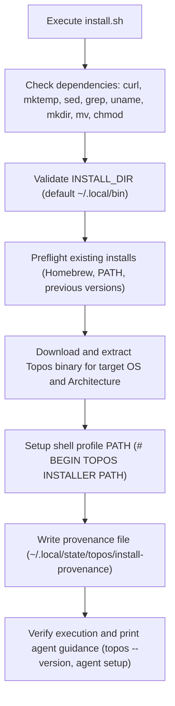
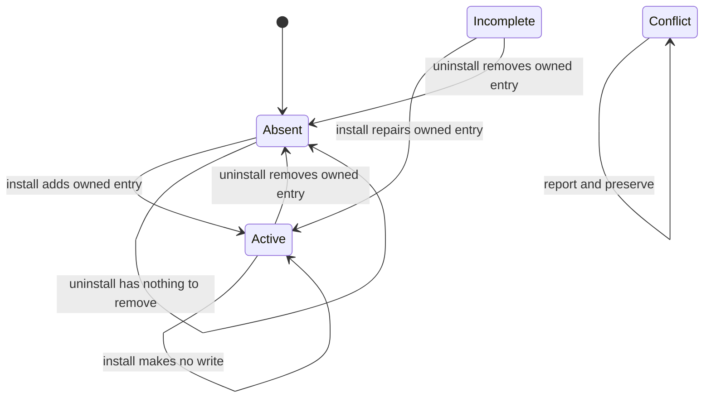
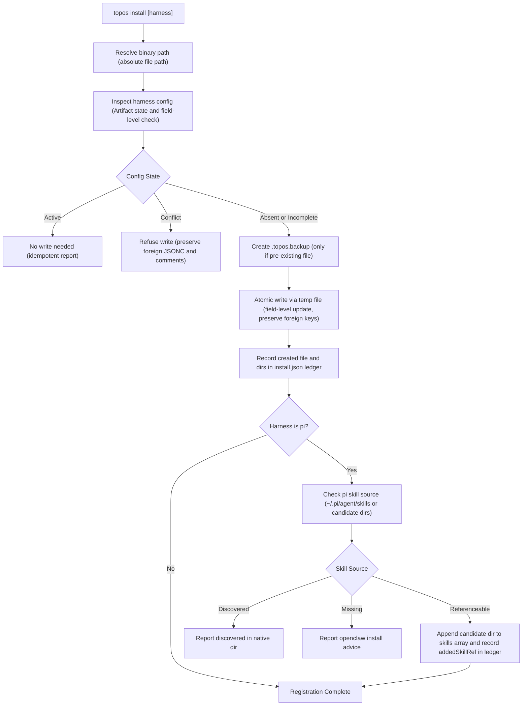

# Harness & Plugin Registration Workflow

Topos integrates into AI agent workflows through binary distribution, plugin manifests, and agent-harness Model Context Protocol (MCP) server registration. The `topos install`, `topos uninstall`, and `topos status` CLI subcommands manage this user-scope MCP integration boundary. For each supported agent harness, Topos configures a single MCP server entry named `topos`, pointing to an absolute executable path and carrying arguments `["mcp"]`. The command `topos install status` acts as a built-in alias for the status reporting workflow.

The core design principle is **one owned MCP artifact per harness**. pi is the single intentional exception: because pi lacks a built-in MCP client, Topos configures its MCP server manifest while also recording a path reference to an already-installed Topos skill directory in pi's `settings.json`. Topos never writes skill markdown contents, prose instruction blocks, or `@import` directives. For details on the architectural boundaries separating CLI tools, agent plugins, and skill packages, see [distribution surfaces](../integrations/distribution.md).

## Installer Lifecycle and Shell Distribution

Topos provides a shell installer script (`install.sh`) for automated binary deployment alongside direct CLI usage. The installer verifies required POSIX shell utilities (`curl`, `mktemp`, `sed`, `grep`, `uname`, `mkdir`, `mv`, `chmod`), validates the target directory (`INSTALL_DIR`, defaulting to `~/.local/bin`), preflights existing installations (such as Homebrew deployments or existing PATH binaries), extracts the `topos` executable for the target platform, configures shell profile `PATH` entries using `# BEGIN TOPOS INSTALLER PATH` and `# END TOPOS INSTALLER PATH` markers when necessary, records installation provenance in `${XDG_STATE_HOME:-$HOME/.local/state}/topos/install-provenance`, and verifies binary execution.


*Installer lifecycle flow for shell-based binary distribution and environment setup.*

Topos also provides standardized plugin and package metadata manifests for registry discovery and dedicated MCP transport execution:
- `.mcp/server.json`: Standard Model Context Protocol server manifest (conforming to schema version `2025-12-11`), declaring package registry bindings (PyPI `topos-mcp`), `uvx` runtime hints, and stdio transport configurations.
- `agent-plugin/plugin.json`: Plugin manifest for agent plugin ecosystems (conforming to `agent-plugins.org` schema `1.0.0`), declaring plugin ownership (`Krv Labs`), licensing (`BSD-3-Clause`), and repository links.
- `topos-mcp`: Dedicated stdio binary (`topos/mcp/src/main.rs`) serving Model Context Protocol requests directly or launched via `topos mcp`. It honors `--version` and `--help` flags to prevent handshake stalls during diagnostic queries.

## Supported Agent Harnesses and Metadata Formats

The static `HARNESSES` table in `topos/cli/src/commands/install/harness.rs` defines the 10 supported agent integration targets. Each entry declares the harness identifier, user configuration path resolution function, artifact format handler, presence detector predicate, human-readable status messages, harness-specific operational notes, and whether the pi skill directory reference mechanism applies. CLI execution iterates over this table rather than hardcoding harness-specific branches. Detection pre-checks interactive UI choices but never prevents explicit command-line selection.

| Id | Harness | User configuration | Topos-owned MCP location | Format / Structure |
| --- | --- | --- | --- | --- |
| `claude` | Claude Code | `~/.claude.json` | `mcpServers.topos` | `McpJson` (`command`, `args`) |
| `claude-desktop` | Claude Desktop | platform-specific Claude Desktop configuration | `mcpServers.topos` | `McpJson` (`command`, `args`) |
| `codex` | Codex CLI | `~/.codex/config.toml` | `[mcp_servers.topos]` | `McpToml` (TOML table) |
| `gemini` | Gemini CLI | `~/.gemini/settings.json` | `mcpServers.topos` | `McpJson` (`command`, `args`) |
| `copilot` | GitHub Copilot CLI | `~/.copilot/mcp-config.json` | `mcpServers.topos` | `McpJson` (`command`, `args`) |
| `cursor` | Cursor | `~/.cursor/mcp.json` | `mcpServers.topos` | `McpJson` (`command`, `args`) |
| `vscode` | VS Code | platform-specific `Code/User/mcp.json` | `servers.topos` | `VsCodeJson` (`type: "stdio"`, `command`, `args`) |
| `antigravity` | Google Antigravity | `~/.gemini/config/mcp_config.json` | `mcpServers.topos` | `McpJson` (`command`, `args`) |
| `pi` | pi | `~/.pi/agent/mcp.json` | `mcpServers.topos` | `McpJson` (`command`, `args`) + pi skill ref |
| `opencode` | OpenCode | `~/.config/opencode/opencode.jsonc` (or `opencode.json` / `config.json`) | `mcp.topos` | `OpenCodeJson` (`type: "local"`, array `command`) |

Configuration paths adapt dynamically per OS: Claude Desktop and VS Code select `~/Library/Application Support/...` on macOS, `~/.config/...` on Linux, and `%APPDATA%/...` on Windows. OpenCode configuration resides under `~/.config/opencode/`, probing `opencode.jsonc`, `opencode.json`, or `config.json` (defaulting to `opencode.jsonc` when creating a new file). Path resolution accepts an explicit home directory reference, enabling end-to-end testing in isolated temporary directories without touching real user environments.

### Executable Path Resolution and File Identity

Topos requires absolute executable paths when registering MCP servers because GUI-launched desktop applications on macOS (such as Claude Desktop, Cursor, or Google Antigravity) inherit a minimal PATH (`/usr/bin:/bin:/usr/sbin:/sbin`) and cannot resolve bare binary names like `"topos"`.

When resolving the absolute path (`resolve_binary_path`), Topos inspects `$PATH` directories to locate a stable alias matching the physical file identity of the running binary (`current_exe()`). Comparison is performed by file metadata identity (`fs::metadata` and device/inode comparison), which follows symlinks. This ensures that Homebrew installations record stable `$PATH` symlink locations (such as `/opt/homebrew/bin/topos` or `/usr/local/bin/topos`) rather than version-pinned Cellar paths (`/opt/homebrew/Cellar/topos/X.Y.Z/bin/topos`), avoiding silent harness breakage when Homebrew updates the package.

## State Machine, Field-Level Ownership, and Non-Mutation


*Per-harness MCP Artifact lifecycle. Conflict deliberately has no mutation transition; pi's separate skill-reference outcome is reported alongside.*

Topos evaluates each harness configuration against four artifact states:
- **Active**: A Topos-owned MCP server entry exists, contains all required structure and type attributes, and points to an executable matching the file identity of the running Topos binary.
- **Incomplete**: An entry recognized as Topos-owned exhibits path drift (pointing to a different executable or stale binary location), missing `"type": "stdio"` (VS Code), or missing `"type": "local"` / combined command array formatting (OpenCode). Running `topos install <id>` repairs the entry in place.
- **Conflict**: The configuration file cannot be parsed as valid JSON or TOML, a required container object holds an incompatible data type, the `topos` key exists but does not match Topos ownership rules, or JSONC modification would strip foreign comments or trailing commas. `install` refuses to modify conflict files, and `uninstall` leaves them untouched.
- **Absent**: No Topos entry exists in the configuration file. `uninstall` is idempotent and does not create ledger records when an entry is absent.

### Field-Level Ownership Rules

Topos uses field-level ownership detection rather than comparing entire configuration objects. An entry is recognized as Topos-owned if its executable filename is `topos` or `topos.exe` and its arguments are exactly `["mcp"]` (either as a standalone `args` array or as the second element in OpenCode's combined `command` array), even if the path no longer exists on disk. This enables `topos install` to self-heal drifted paths while preventing accidental overwrites of user-defined MCP configurations. Topos writers update only Topos-owned keys (`command`, `args`, `type`) while preserving surrounding server definitions, unrelated configuration keys, and non-Topos entries.


*Detailed harness registration pathway illustrating binary resolution, inspection, backup creation, atomic updates, ledger authorization, and pi skill handling.*

## Install Flow and Backup Snapshot Management

When modifying an existing configuration file, `topos install` writes a pristine backup snapshot to `<config>.topos.backup` prior to applying changes. Backup creation is subject to strict invariants:
- **No overwrite of pristine backups**: Backups are created only when modifying a pre-existing file for the first time. If `<config>.topos.backup` already exists, subsequent `install` runs preserve the original pre-install snapshot rather than replacing it with a snapshot containing Topos-modified state.
- **No backup for newly created files**: When Topos creates a configuration file from scratch, no `.topos.backup` file is created because there was no prior user configuration to preserve.
- **Atomic updates and symlink target resolution**: File modifications land in a temporary sibling file (`<config>.topos.tmp`) before being atomically renamed into place. When the target configuration file is a symlink (such as dotfiles managed via `stow` or `chezmoi`), Topos resolves the symlink target via `resolve_symlink` and writes to the real destination file, ensuring the symlink structure is not broken or replaced by a regular file.

## Pi Harness Mechanics and Skill Directory References

pi does not feature a native MCP client: its `~/.pi/agent/mcp.json` registration remains inactive until the user installs the `pi-mcp-adapter` extension. Consequently, `topos status` and `topos install` output include explicit notes guiding the user to install the adapter.

To support pi without embedding skill contents inside Topos, Topos manages a skill directory reference in `~/.pi/agent/settings.json` under the `skills` array key:

| Skill Source Outcome | `topos install pi` Behavior | `topos status` Report |
| --- | --- | --- |
| Topos skill present in `~/.pi/agent/skills` | No reference written; pi discovers it natively (`Discovered`). | `Discovered` message rendered; no configuration modified. |
| Topos skill in `~/.agents/skills` or `~/.claude/skills` | Append candidate directory to `skills` array (`Referenceable`). | `Active` status rendered once referenced. |
| No installed Topos skill located | Do not create `settings.json`; print `openclaw skills install @Krv-Labs/topos` guidance (`Missing`). | `Absent` status rendered with installation advice. |

This mechanism references an external skill directory rather than creating or writing skill contents. Insertion is idempotent, appends to the existing `skills` array without overwriting foreign entries, and preserves unrelated settings. `topos status --json` tracks pi's `skillRef` state separately from its MCP entry state (`active`, `conflict`, `discovered`, or `unavailable`).

## Status Inspection and Read-Only Residue Rules

`topos status` inspects binary resolution, evaluates all 10 harness configurations, scans for legacy residue, and formats human-readable CLI output or structured JSON (`topos status --json`).

```bash
topos status --json
```

The JSON output exposes the resolved binary path, active integration count, total harness count, array of per-harness status objects, residue entries, and pi skill reference state.

### Read-Only Residue Scanning

Topos implements a read-only residue scanner (`topos/cli/src/commands/install/residue.rs`) governed by a fixed set of detection rules (`RULES`):
1. `.copilot/copilot-instructions.md`: Detects legacy `<!-- topos:start -->` instruction blocks written by earlier Topos drafts.
2. `.gemini/GEMINI.md`: Detects legacy `@import` lines referencing `topos-skill.md`.
3. `.gemini/topos-skill.md`: Detects legacy skill text dropped by earlier drafts.
4. `.claude/skills/topos/SKILL.md`: Detects Topos agent skills installed via OpenClaw / ClawHub / Hermes.
5. `.agents/skills/topos/SKILL.md`: Detects Topos agent skills in OpenClaw's shared namespace (`~/.agents/.skill-lock.json`).

Residue scanning is strictly read-only. Topos never modifies, edits, or deletes residue files during `install` or `uninstall` operations because these files are shared with external tools or managed by external package managers like OpenClaw. `topos status` reports residue items alongside remediation advice (such as running `openclaw skills uninstall @Krv-Labs/topos` or manually removing obsolete `@import` lines).

Google Antigravity also triggers a specific operational note: legacy data-directory `mcp_config.json` files can overwrite `~/.gemini/config/mcp_config.json` on application launch unless migration markers or compatibility symlinks are established. Topos never writes directly into legacy data directories.

## Persistent State Ledger and Authorization Mechanics

Topos maintains a persistent ownership ledger at `~/.local/state/topos/install.json` (or `%APPDATA%\topos\install.json` on Windows). The ledger tracks filesystem changes created specifically by `topos install`:

```json
{
  "harnesses": {
    "pi": {
      "createdFiles": [
        "/home/user/.pi/agent/mcp.json"
      ],
      "addedSkillRef": true
    },
    "claude": {
      "createdFiles": [
        "/home/user/.claude.json"
      ]
    }
  },
  "createdDirs": [
    "/home/user/.pi",
    "/home/user/.pi/agent"
  ]
}
```

The ledger records:
- `createdFiles`: Configuration files brought into existence by Topos (per harness).
- `addedSkillRef`: Boolean indicating that Topos appended a skill reference to pi's `settings.json`.
- `createdDirs`: Parent directories created during installation writes across all harnesses.

The ledger parser automatically upgrades legacy flat schema formats (`{"<harness_id>": {"createdFiles": [...]}}`) to the current structured schema upon reading.

## Leave-No-Trace Uninstallation Workflow

`topos uninstall` removes Topos-owned MCP server entries while leaving foreign configurations untouched. Uninstallation relies on ledger authorization to ensure complete cleanup without over-deleting user files.

### Deletion and Pruning Rules

1. **Conditional Empty File Removal**: A configuration file emptied by entry removal is deleted *only if* the state ledger confirms Topos originally created the file (`was_created_by_install`). A pre-existing user file that becomes empty is preserved.
2. **Pi Skill Reference Removal**: pi's skill directory reference is removed from `settings.json` *only if* recorded in `addedSkillRef`. If the `skills` array becomes empty, the `skills` key is removed while preserving other settings keys. External skill directories are never deleted.
3. **Deepest-First Directory Pruning**: Empty directories recorded in `createdDirs` are pruned in deepest-first order using `prune_dirs`. Pruning skips directories that contain remaining user files or subdirectories (permitting minor system metadata like `.DS_Store`).
4. **Protected System Roots**: Directory pruning explicitly excludes protected root directories (`$HOME`, `~/.local`, `~/.local/state`, `~/.config`, `~/Library`, `~/Library/Application Support`, `%APPDATA%`).
5. **Shared Cache Preservation**: Shared cache bookkeeping directories (such as `~/.local/state/topos/cache-index/`) are retained across uninstallation. If shared cache data remains in `state_dir()`, the state directory itself is preserved, and a status message explains the retention.

### Execution Sequence

Uninstallation executes cleanup steps in strict sequence to preserve authorization state throughout execution:
1. Purge `.topos.backup` snapshot files for selected harnesses if `--purge-backups` is specified.
2. Remove Topos MCP server entries and clear harness ledger entries (`clear_created_files`).
3. Verify whether all Topos harness registrations and skill references across all harnesses have been removed (`uninstalled_everything`).
4. Read created directories from the ledger and filter out shared state paths (`prune_candidates`).
5. Remove `install.json` and prune candidate directories deepest-first.
6. Delete update-check notification caches (`remove_cache`).
7. Prune `state_dir()` last, provided no shared cache bookkeeping remains.

## Invocation Safety, Interactivity, and Execution Modes

Topos evaluates terminal streams to select an appropriate execution interactivity mode (`Interactivity`):
- **Interactive**: `stderr` is a TTY terminal. Topos presents interactive multi-select menus for target harness selection and prompts for confirmation before applying destructive changes.
- **Headless**: Neither `stdin`, `stdout`, nor `stderr` is a TTY (e.g., automated CI scripts). `topos install` requires `--all` or explicit harness identifiers. `topos uninstall` automatically selects non-absent integrations and executes without prompting.
- **Ambiguous**: `stderr` is redirected (e.g., `topos uninstall 2>log.txt`) while `stdin` or `stdout` remains attached to a TTY. To prevent non-interactive destructive modifications, uninstallation in ambiguous mode requires explicit `--yes` or `--dry-run` flags; otherwise, the command aborts with an error.

Common command invocations:

```bash
# Preview installation changes across all harnesses
topos install --all --dry-run

# Register Topos in specific harnesses
topos install claude cursor opencode

# Non-interactive uninstallation with backup purging
topos uninstall --all --yes --purge-backups
```

## Integration Verification Suite

The integration test suite (`topos/cli/tests/install_e2e.rs`) validates harness installation contracts against isolated scratch directory environments (`$HOME` override). The test suite verifies:
- Registration of absolute command paths and exact `["mcp"]` argument structures across all 10 harnesses.
- Idempotency of repeated `topos install` executions without unnecessary file writes or timestamp updates.
- Detection of path drift and execution repair without clobbering existing `.topos.backup` snapshot files.
- Complete, leave-no-trace removal during `topos uninstall`, confirming directory pruning and authorization ledger cleanup.
- Resilience against non-standard JSON formatting, TOML comment preservation (via `toml_edit`), and OpenCode JSONC multi-file probing.

## Related Documentation

- [Distribution Surfaces](../integrations/distribution.md) — Technical details on binary packaging, MCP manifests, and plugin schemas.
- [Testing & Release Operations](../operations/testing-and-release.md) — E2E test suites, release pipelines, and package publishing workflows.
- [Agent & CLI Interaction Workflows](agent-and-cli.md) — Tool execution mechanics and MCP transport architecture.
- [Quickstart Guide](../quickstart.md) — Getting started with Topos CLI and agent integration.
