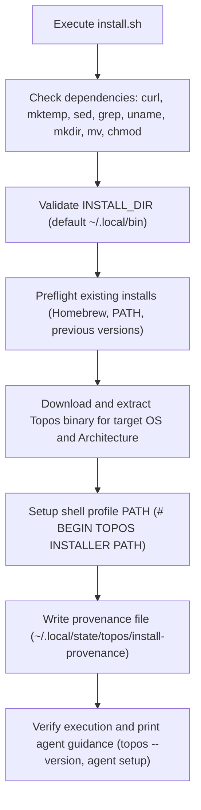
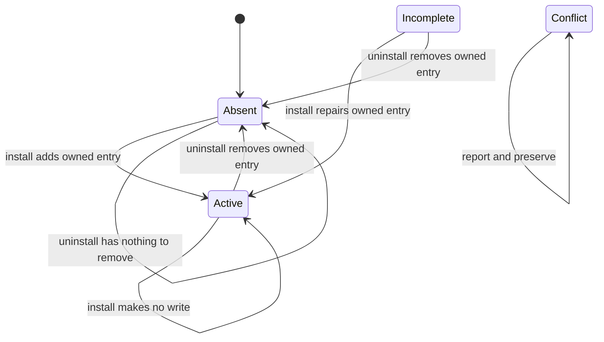
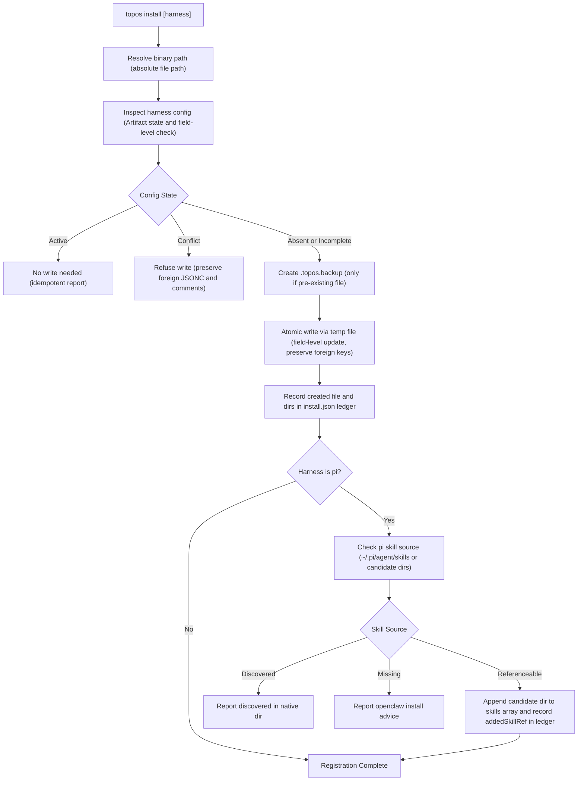

# Harness & Plugin Registration Workflow

Topos integrates into AI agent workflows through binary distribution, plugin manifests, and agent-harness Model Context Protocol (MCP) registration. `topos install`, `topos uninstall`, and `topos status` manage a user-scope MCP integration boundary. For each supported agent harness, Topos manages a single MCP server entry named `topos`, configured with an absolute executable `command` and exactly `args: ["mcp"]`. `topos install status` is an alias for the status workflow.

The core rule is one MCP artifact per harness; **pi is the intentional exception**, as it may additionally receive a path reference to an already-installed Topos skill directory. Topos never writes skill contents, instruction blocks, or `@import` directives. See [distribution surfaces](../integrations/distribution.md) for the ownership boundary between CLI tools, agent plugins, and skill packages.

## Installer Lifecycle and Shell Distribution

Topos supplies a shell installer (`install.sh`) for automated binary deployment alongside direct CLI execution. The installer verifies shell dependencies (`curl`, `mktemp`, `sed`, `grep`, `uname`, `mkdir`, `mv`, `chmod`), preflights existing installations (such as Homebrew or existing binary builds), deploys the `topos` binary into `INSTALL_DIR` (`~/.local/bin` by default), configures shell profile PATH entries when required (using `# BEGIN TOPOS INSTALLER PATH` markers), records an installation provenance record in `${XDG_STATE_HOME:-$HOME/.local/state}/topos/install-provenance`, and verifies execution.


*Installer lifecycle flow for shell-based binary distribution and environment setup.*

Topos also provides standardized plugin and package metadata manifests for registry discovery and dedicated MCP transport execution:
- `.mcp/server.json`: Standard Model Context Protocol server manifest (conforming to schema version `2025-12-11`), declaring package registry bindings (PyPI `topos-mcp`), `uvx` runtime hints, and stdio transport configurations.
- `agent-plugin/plugin.json`: Plugin manifest for agent plugin ecosystems (conforming to `agent-plugins.org` schema `1.0.0`), declaring plugin ownership (`Krv Labs`), licensing (`BSD-3-Clause`), and repository links.
- `topos-mcp`: Dedicated stdio binary (`topos/mcp/src/main.rs`) serving Model Context Protocol requests directly or launched via `topos mcp`. It honors `--version` and `--help` flags to prevent handshake stalls during diagnostic queries.

## Supported Agent Harnesses and Metadata Formats

The `HARNESSES` table defines the supported agent integration targets. Each entry declares the harness identifier, user configuration path, artifact format, presence detector function, user messages, operational notes/caveats, and whether the pi skill reference applies. Command logic iterates this table rather than hardcoding harness-specific branches. Detection pre-checks interactive choices but never blocks an explicit command-line selection.

| Id | Harness | User configuration | Topos-owned MCP location | Format / Structure |
| --- | --- | --- | --- | --- |
| `claude` | Claude Code | `~/.claude.json` | `mcpServers.topos` | `McpJson` (`command`, `args`) |
| `claude-desktop` | Claude Desktop | platform-specific Claude Desktop configuration | `mcpServers.topos` | `McpJson` (`command`, `args`) |
| `codex` | Codex CLI | `~/.codex/config.toml` | `[mcp_servers.topos]` | `McpToml` (TOML table) |
| `gemini` | Gemini CLI | `~/.gemini/settings.json` | `mcpServers.topos` | `McpJson` (`command`, `args`) |
| `copilot` | GitHub Copilot CLI | `~/.copilot/mcp-config.json` | `mcpServers.topos` | `McpJson` (`command`, `args`) |
| `cursor` | Cursor | `~/.cursor/mcp.json` | `mcpServers.topos` | `McpJson` (`command`, `args`) |
| `vscode` | VS Code | platform-specific `Code/User/mcp.json` | `servers.topos` | `VsCodeJson` (`type: "stdio"`, `command`, `args`) |
| `antigravity` | Google Antigravity | `~/.gemini/config/mcp_config.json` | `mcpServers.topos` | `McpJson` (`command`, `args`) |
| `pi` | pi | `~/.pi/agent/mcp.json` | `mcpServers.topos` | `McpJson` (`command`, `args`) + pi skill ref |
| `opencode` | OpenCode | `~/.config/opencode/opencode.jsonc` (or `opencode.json` / `config.json`) | `mcp.topos` | `OpenCodeJson` (`type: "local"`, array `command`) |

Platform paths adapt across environments: Claude Desktop and VS Code target `~/Library/Application Support/...` on macOS, `~/.config/...` on Linux, and `%APPDATA%/...` on Windows. OpenCode configuration resides in `~/.config/opencode/`, probing `opencode.jsonc`, `opencode.json`, or `config.json` (defaulting to `opencode.jsonc`). Path resolution functions accept the home directory, enabling end-to-end testing against isolated scratch directories without affecting developer configurations.

Plain JSON registrations specify `command` and `args`; Codex uses `toml_edit` to preserve comments and formatting; VS Code requires `"type": "stdio"`; OpenCode uses `mcp` with `"type": "local"` and an array `command` containing `["<binary>", "mcp"]`. The resolved command is stored as an absolute path, while command comparison uses file identity (inode/file-id) so stable `$PATH` symlinks can be recorded without version churn.

## State Machine, Field-Level Ownership, and Non-Mutation


*Per-harness MCP Artifact lifecycle. Conflict deliberately has no mutation transition; pi's separate skill-reference outcome is reported alongside.*

- **Active**: The `topos` entry is recognized as Topos-owned, possesses required configuration fields, and points to an executable binary matching the running executable.
- **Incomplete**: The entry is owned by Topos but exhibits path drift (pointing to an old executable), missing `type: stdio` (VS Code), or missing `type: local` / array `command` formatting (OpenCode). Re-running `topos install <id>` repairs the entry.
- **Conflict**: The configuration file is unparsable JSON/TOML, a required container object has an incompatible type, the `topos` key is not recognized as Topos-owned, or a necessary VS Code or OpenCode JSONC update would strip comments or trailing commas. `install` refuses modification, and `uninstall` leaves the file untouched.
- **Absent**: No Topos entry exists. `uninstall` is idempotent and does not create ledger records to record absence.

Topos uses field-level ownership rules rather than whole-object comparison. An entry is recognized as Topos-owned when its executable filename is `topos` or `topos.exe` and its arguments are exactly `["mcp"]` (either as a standalone `args` array or as the second element in OpenCode's combined `command` array), even if the path no longer exists. This enables repairing or removing stale paths while preventing accidental modification of hand-authored `topos` entries. Writers modify only Topos-owned keys (`command`, `args`, and `type`) while preserving sibling server definitions, foreign keys, and existing formatting.


*Detailed harness registration pathway illustrating binary resolution, inspection, backup creation, atomic updates, ledger authorization, and pi skill handling.*

## Install Flow and Pi's Skill Directory Reference

When modifying a pre-existing configuration file, `topos install` writes a pristine backup snapshot to `<config>.topos.backup` prior to modification. No backup is created when Topos creates a new configuration file from scratch, and existing pristine backups are preserved untouched during subsequent repair operations. Re-running `install` on an already active configuration performs no file writes.

pi lacks a native MCP client: its MCP registration is inactive until the user installs the `pi-mcp-adapter` extension, so `topos status` and `topos install` output include adapter caveats. pi also supports a direct skill directory integration pathway through `~/.pi/agent/settings.json`:

| Skill source outcome | `topos install pi` behavior |
| --- | --- |
| Topos skill present in `~/.pi/agent/skills` | No reference written; pi discovers it natively (`Discovered`). |
| Topos skill in `~/.agents/skills` or `~/.claude/skills` | Append candidate directory to `skills` array (`Referenceable`). |
| No installed Topos skill located | Do not create `settings.json`; report `openclaw skills install @Krv-Labs/topos` guidance (`Missing`). |

This mechanism references an external skill search directory rather than copying skill files. Insertion is idempotent, appends to the existing `skills` array without overwriting foreign entries, and preserves unrelated settings. `topos status --json` reports pi's `skillRef` status independently (`active`, `conflict`, `discovered`, or `unavailable`) so that MCP server status and skill reference status remain distinct.

## Status Inspection and Read-Only Residue

`topos status` inspects the executable path, checks all entries in `HARNESSES`, scans for legacy residue, and prints structured console output or machine-readable JSON (`topos status --json`). The JSON output includes resolved binary paths, active count totals, per-harness status details, residue records, and pi skill reference state.

Residue scanning is strictly read-only. `topos status` identifies draft-era Copilot instruction blocks, Gemini `@import` directives, copied skill files, and foreign-key duplicate MCP registrations. Topos never modifies or deletes residue artifacts during install or uninstall operations because these files may be shared across tools or managed by external distribution channels (such as OpenClaw, ClawHub, or Hermes).

Google Antigravity includes a specific migration warning: prior to migration, a legacy data-directory `mcp_config.json` can overwrite `~/.gemini/config/mcp_config.json` on application launch. Migration markers or back-compatibility symlinks suppress the warning. Topos never writes directly to legacy data directories.

## Ledger-Authorized Cleanup and Uninstallation

Topos uses a persistent state ledger located at `~/.local/state/topos/install.json` (or `%APPDATA%\topos\install.json` on Windows) to track ownership authority. The ledger records:
- Files created by `install` per harness (`createdFiles`).
- Directory paths created by `install` writes (`createdDirs`).
- Pi skill references appended by `install` (`addedSkillRef`).

```json
{
  "harnesses": {
    "pi": {
      "createdFiles": ["/home/user/.pi/agent/mcp.json"],
      "addedSkillRef": true
    }
  },
  "createdDirs": ["/home/user/.pi", "/home/user/.pi/agent"]
}
```

The ledger accepts legacy flat schema formats for backward compatibility and upgrades them to the current schema on write.

`topos uninstall` removes only recognized, Topos-owned MCP entries. An empty configuration file is deleted only if the ledger confirms Topos created it. For pi, the skill array reference is removed only if recorded in `addedSkillRef`. If the `skills` array becomes empty, the key is removed, but external skill directories and content are never deleted.

Uninstallation performs cleanup in a strict sequence to preserve authorization evidence:
1. Purge `.topos.backup` files when requested (`--purge-backups`) for selected harnesses only.
2. Remove Topos MCP entries and clear harness ledger records.
3. If all managed MCP registrations and ledger-owned skill references have been removed, prune recorded directories deepest-first if effectively empty (allowing minor system artifacts like `.DS_Store`).
4. Delete `install.json` and prune the state directory last.

Protected system roots—including `$HOME`, `~/.local`, `~/.local/state`, `~/.config`, `~/Library`, `~/Library/Application Support`, and `%APPDATA%`—are excluded from directory pruning. Shared cache indexing data (`~/.local/state/topos/cache-index/`) is preserved across uninstallation and reported in human-readable output.

## Invocation Safety and Verification Suite

Harness arguments are case-insensitive and deduplicated; `--all` processes harnesses in `HARNESSES` table order. In non-interactive environments, `install` requires explicit harness identifiers or `--all`. Headless `uninstall` operations without explicit identifiers select non-absent integrations and execute automatically without prompting. If `stderr` is redirected while `stdin` or `stdout` remains a TTY (ambiguous interactivity), destructive uninstall requires `--yes` or `--dry-run`; interactive runs display planned actions and default to cancellation.

The end-to-end integration test suite (`cargo test -p topos --test install_e2e`) verifies system contracts using the compiled binary against isolated scratch `$HOME` environments with full directory and file snapshotting. Key assertions verified by the suite include:
- Execution of absolute command paths and exact `["mcp"]` arguments across all 10 harnesses.
- Idempotency of repeated `install` runs with zero file rewrites.
- Drift detection and command repair without clobbering pristine pre-install backups.
- Scoped backup purging (`--purge-backups`) that leaves unselected harness backups intact.
- Headless uninstallation and leave-no-trace directory pruning.
- Read-only preservation of residue artifacts, foreign settings, and manually added pi skill references.
- Byte-identical refusal of commented VS Code JSONC files.

Detailed CLI command structures are covered in [Agent and CLI workflows](agent-and-cli.md), and release testing procedures are detailed in [testing and release](../operations/testing-and-release.md).
